

# CalisFacu v1.0

## Informe de cumplimiento del plan de calidad: Sprint 3

Evidencias de las pruebas, herramientas y controles del SQAP 1.2

Equipo L-001 · COM450 Calidad de Software · Universidad San Francisco Xavier · Gestión II/2026

Cliente piloto: Unidad Educativa Nazareno

30/10/2026 · develop <code>0c4791d</code> · release candidate <code>v1.0.0-rc.1</code>

## 1. Propósito y alcance

Este informe muestra, con capturas, que lo que el SQAP 1.2 promete para el Sprint 3 se ejecutó y con qué resultado. El
Sprint 3 entregó US-06 (panel de riesgo), US-07 (boletín en PDF con cola), US-20 (vinculación padre–estudiante) y US-11
(consulta del boletín). Las capturas son una muestra: el detalle completo está en Jenkins, SonarQube Cloud, GitHub y en
`docs/evidencias/`.

Complementa al informe de pruebas del sprint (`informe-pruebas-sprint3.md`), que fue rehecho en la auditoría T-056; este
informe agrega lo que se completó el 30/10/2026: el pipeline volvió a verde, la RC1 con JMeter en Jenkins, SonarQube
Cloud, los respaldos, la revisión OWASP y el registro de defectos.

## 2. Resumen de métricas (SQAP, Tabla 9)

| Métrica | Qué mide                                        | Umbral     | Resultado                                                                          | Cumple    | Evidencia        |
| ------- | ----------------------------------------------- | ---------- | ---------------------------------------------------------------------------------- | --------- | ---------------- |
| M01     | Casos de la tabla de cálculo que pasan          | 100 %      | 13 de 13 (la tabla pasó de 5 a 13 casos frontera)                                  | Sí        | Figura 8         |
| M02     | Escenarios E2E críticos que pasan               | 100 %      | E2E contra staging en verde en Jenkins (#36 a #40) y en la corrida de la sección 6 | Sí        | Figuras 2, 14–17 |
| M03     | p95 de "generar boletín" (100 usuarios, 10 min) | ≤ 2000 ms  | 39 ms (55.919 peticiones, Jenkins, RC1)                                            | Sí        | Figuras 18–19    |
| M04     | Tasa de error bajo carga (boletín y planilla)   | < 1 %      | 0,00 % en las dos operaciones                                                      | Sí        | Figuras 19–20    |
| M05     | Cobertura del código nuevo (SonarQube Cloud)    | ≥ 80 %     | 100 % del código nuevo; 88,1 % del total                                           | Sí        | Figuras 21–22    |
| M06     | Cobertura de líneas por módulo crítico          | ≥ 90 %     | notas, calculo, auditoria y familias 100 %; auth 98,6 %                            | Sí        | Figura 9         |
| M07     | Duplicación en el código nuevo                  | ≤ 3 %      | 0,0 % (0,8 % del total)                                                            | Sí        | Figura 21        |
| M08     | Vulnerabilidades altas o críticas               | 0          | 0 (npm audit: 8 bajas y 6 moderadas; SonarQube: seguridad A)                       | Sí        | Figuras 12, 21   |
| M09     | Rutas protegidas que rechazan con 403           | 100 %      | 100 % (`autorizacion.e2e-spec.ts`) y comprobado en staging                         | Sí        | Figuras 9, 25    |
| M11     | Profesores que registran notas sin ayuda        | ≥ 80 %     | No medida: la sesión con 5 profesores está preparada (T-054)                       | Pendiente | —                |
| M12     | Puntaje SUS                                     | ≥ 68       | No medida (T-054)                                                                  | Pendiente | —                |
| M13     | Disponibilidad mensual                          | ≥ 99,0 %   | UptimeRobot activo desde el 30/10: 100 % en staging; producción aún no existe      | Parcial   | Figura 30        |
| M14     | RPO y RTO de la base                            | 24 h y 2 h | Respaldo diario cifrado; restauración de 19 tablas en 1 s                          | Sí        | Figuras 31–32    |
| M15     | Cambios de nota con auditoría completa          | 100 %      | 100 % (`auditoria.e2e-spec.ts` dentro de las 292 pruebas)                          | Sí        | Figura 9         |
| M16     | Errores y advertencias de lint y formato        | 0          | 0                                                                                  | Sí        | Figura 12        |

**Resultado:** 13 de las 15 métricas se cumplen con evidencia; M13 se cumple en staging y se completa con producción;
M11 y M12 requieren la prueba con profesores reales (sección 12).

## 3. Integración continua: Jenkins

El pipeline (`Jenkinsfile`, Multibranch) corre en cada push a develop: lint, pruebas de API y web, dependencias,
análisis estático, build, despliegue a staging, smoke test y E2E. Entre el 25/10 y el 30/10 estuvo en rojo por el
defecto CAL-001 (sección 10); desde el build #36 está en verde.

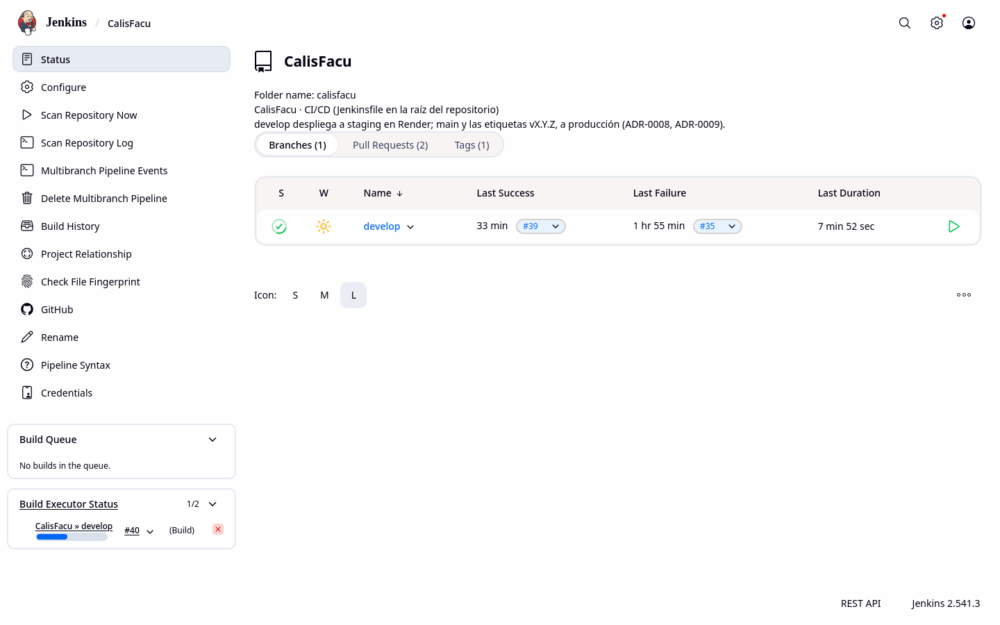

_Figura 1. Job Multibranch "CalisFacu": la rama develop en verde (las etiquetas, como v1.0.0-rc.1, están en su propia pestaña; Figura 18)._

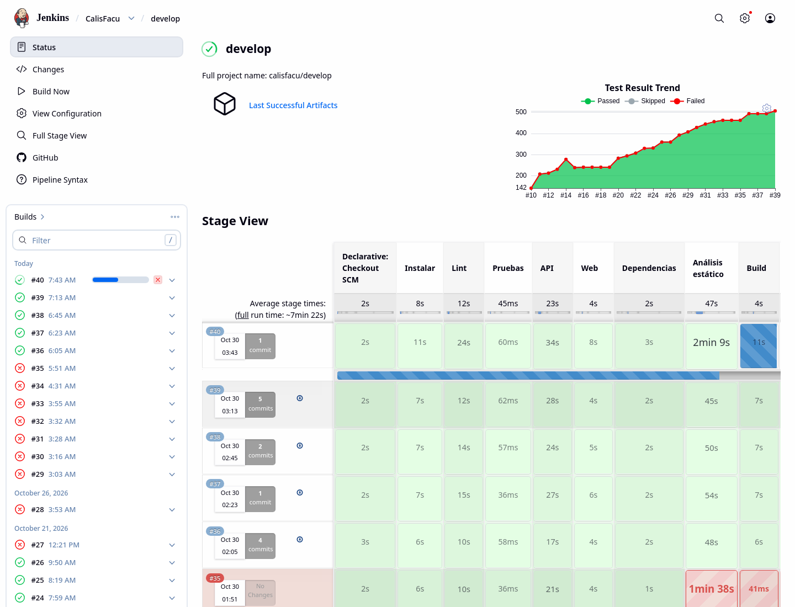

_Figura 2. develop: builds #36 a #40 en verde después de la corrección de CAL-001 (los #28 a #35 en rojo). La
tendencia de pruebas sube hasta más de 500._

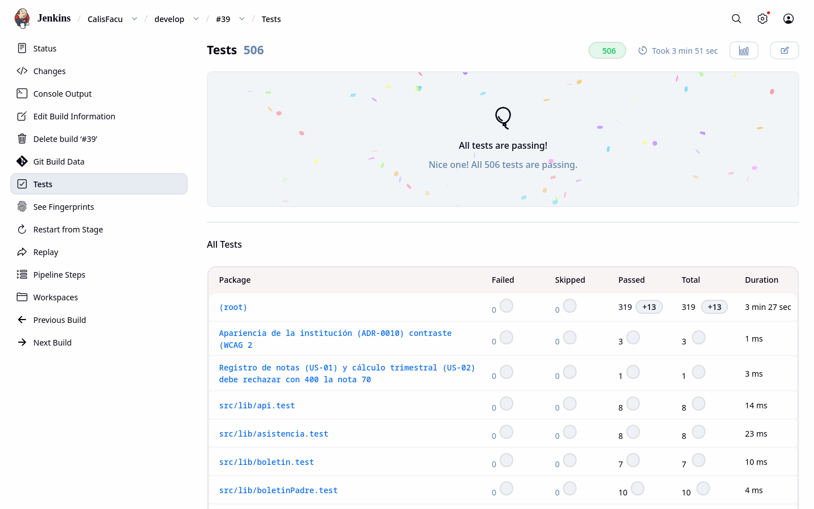

_Figura 3. Informe JUnit publicado por Jenkins para el build #39 (API y web), sin fallos._

## 4. Control de versiones y configuración del repositorio

Se trabaja directo en develop (ADR-0008) con Conventional Commits y referencia a la historia o al defecto. Desde el
30/10, develop es la rama por defecto en GitHub y las dos ramas permanentes están protegidas con rulesets.

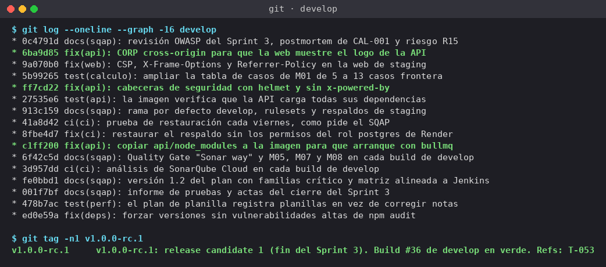

_Figura 4. Commits del cierre del Sprint 3 y etiqueta v1.0.0-rc.1._

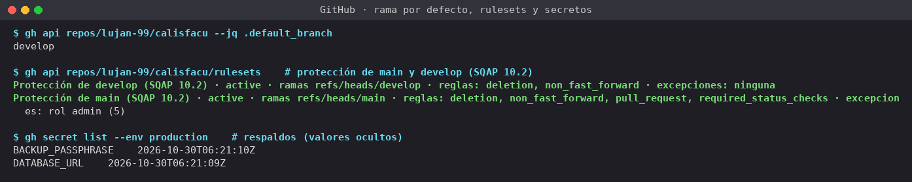

_Figura 5. Rama por defecto, protección de main (PR, check de Jenkins, sin force push; solo el administrador puede
saltarla) y de develop, y secretos de los respaldos._

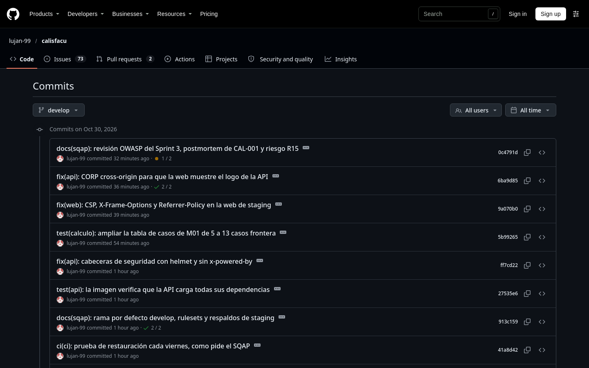

_Figura 6. Commits de develop en GitHub con el estado de Jenkins de cada uno._

## 5. Pruebas unitarias y de integración

### 5.1 API (Jest + Supertest con PostgreSQL real)

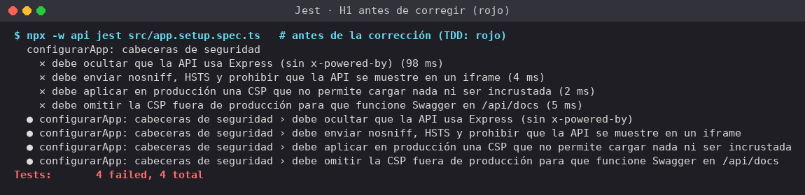

_Figura 7a. TDD: las pruebas de las cabeceras de seguridad fallan antes de la corrección._

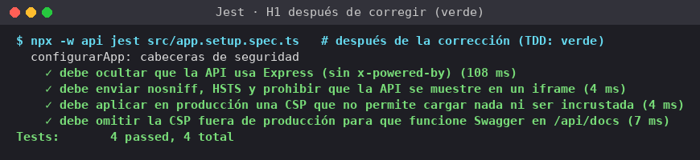

_Figura 7b. Las mismas pruebas pasan después de agregar helmet._

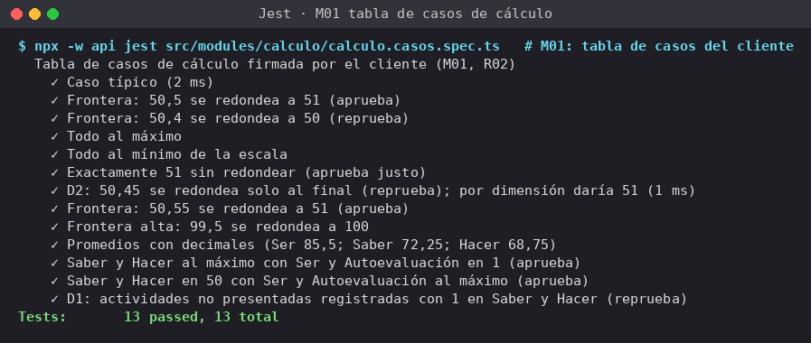

_Figura 8. M01: los 13 casos de la tabla de cálculo (D1 y D2 incluidos) dan el resultado esperado._

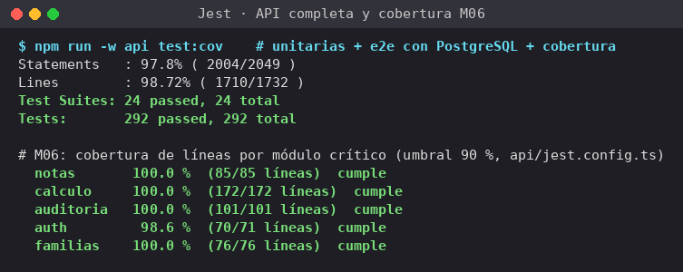

_Figura 9. 292 pruebas de la API (24 suites, unitarias y e2e) en verde; M06 por módulo crítico._

### 5.2 Web (Vitest + Testing Library)

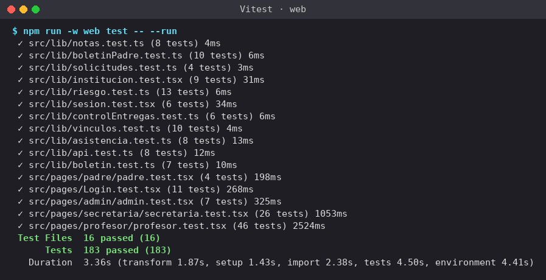

_Figura 10. 183 pruebas de las pantallas React en verde._

### 5.3 Regresión de defectos

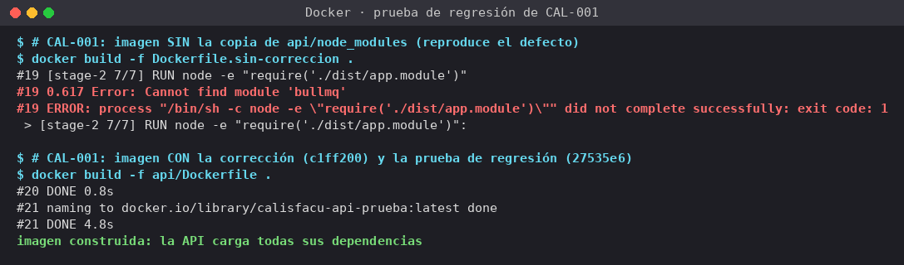

_Figura 11. La imagen Docker verifica al construirse que la API carga sus dependencias: sin la corrección de CAL-001
falla con `Cannot find module 'bullmq'`; con la corrección se construye._

### 5.4 Estándar de código y dependencias

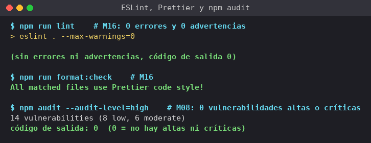

_Figura 12. M16: ESLint y Prettier sin observaciones. M08: `npm audit --audit-level=high` sin vulnerabilidades altas ni
críticas._

## 6. Pruebas E2E: Cypress contra staging

Cypress recorre el sistema en el navegador contra staging. En Jenkins corre en cada build de develop (etapa E2E, builds
#36 a #40 en verde); para este informe se ejecutó además la suite completa el 30/10/2026 contra staging.

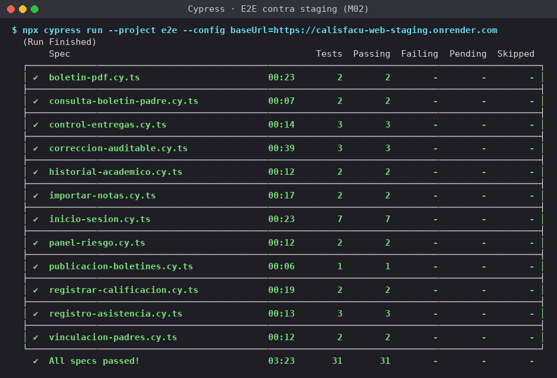

_Figura 14. M02: 31 de 31 escenarios en verde en 12 archivos (3 min 23 s) contra staging._

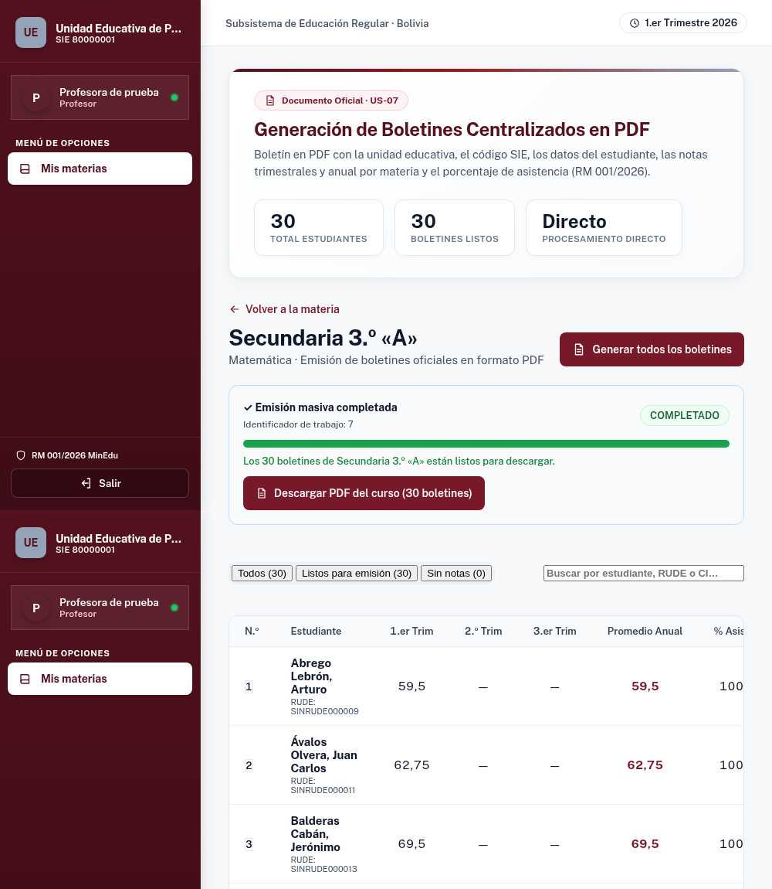

_Figura 15. Captura tomada por Cypress (US-07, criterio 3): la cola terminó y avisa que los 30 boletines están listos._

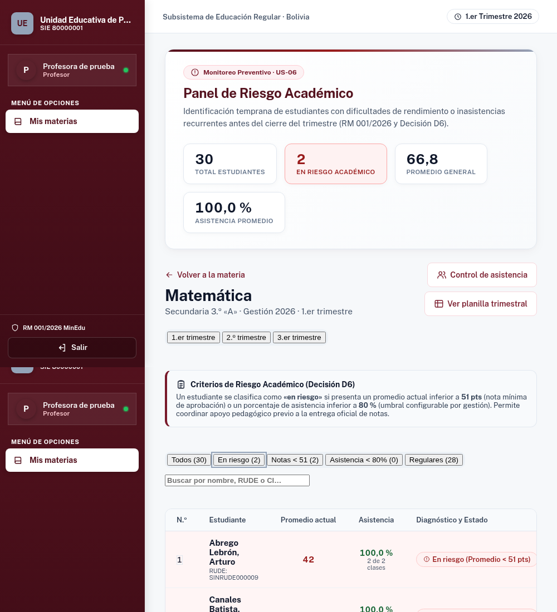

_Figura 16. Captura tomada por Cypress (US-06): filtro de estudiantes en riesgo._

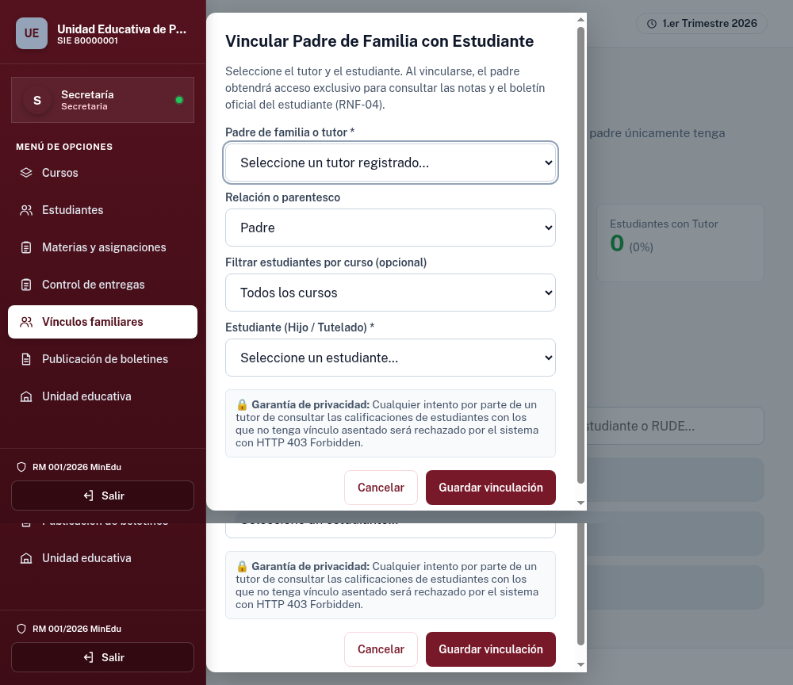

_Figura 17. Captura tomada por Cypress (US-20): la secretaria crea un vínculo padre–estudiante._

## 7. Pruebas de rendimiento: JMeter en Jenkins (RC1)

La etiqueta `v1.0.0-rc.1` ejecutó la etapa Rendimiento: 100 usuarios concurrentes durante 10 minutos por operación,
contra la API compilada en el agente de Jenkins. El build falla si el p95 supera 2000 ms o el error llega a 1 %.

| Operación          | Peticiones | Error  | Media | p90    | p95       | p99    | Peticiones/s |
| ------------------ | ---------- | ------ | ----- | ------ | --------- | ------ | ------------ |
| Generar boletín    | 55.919     | 0,00 % | 19 ms | 30 ms  | **39 ms** | 61 ms  | 93,0         |
| Registrar planilla | 53.028     | 0,00 % | 74 ms | 151 ms | 178 ms    | 244 ms | 88,3         |

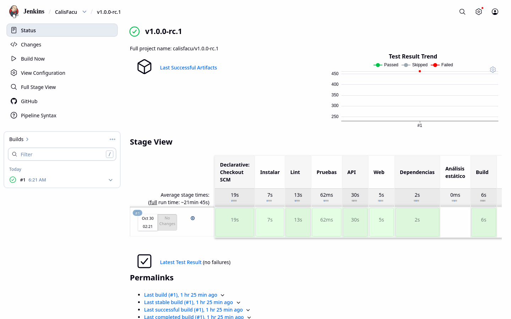

_Figura 18. Build de la etiqueta v1.0.0-rc.1: etapa Rendimiento en verde._

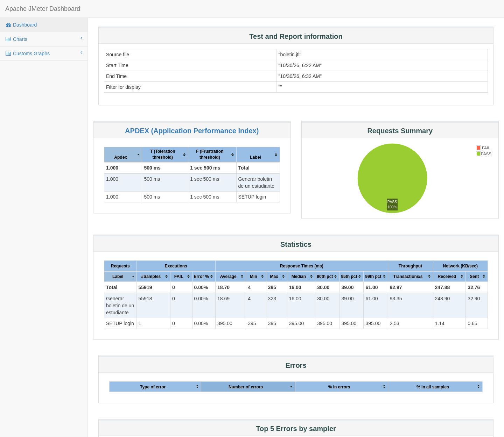

_Figura 19. Dashboard de JMeter de "generar boletín" generado y archivado por Jenkins (descargado del build de la
RC1): 55.919 peticiones, 0 errores, APDEX 1.000._

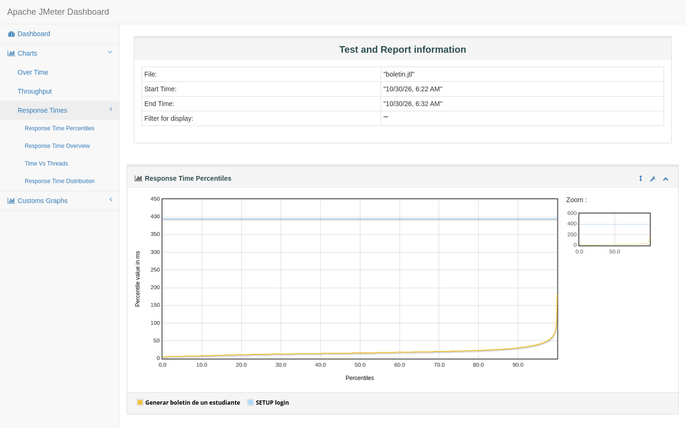

_Figura 19b. Percentiles del tiempo de respuesta del boletín: por debajo de 50 ms hasta el percentil 95; el umbral de
M03 es 2000 ms._

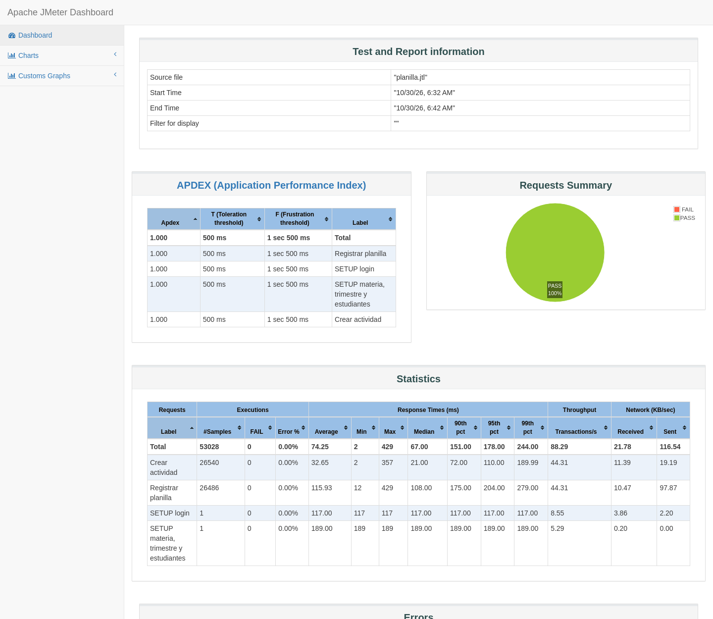

_Figura 20. Dashboard de JMeter de "registrar planilla". Las estadísticas están en `docs/evidencias/v1.0.0-rc.1/`._

## 8. Análisis estático y seguridad

### 8.1 SonarQube Cloud (M05, M07, M08)

Conectado el 30/10/2026 (T-030). El plan gratuito no permite un Quality Gate propio, así que se usa "Sonar way", que
contiene las condiciones de M05, M07 y M08 con los mismos umbrales; la etapa Análisis estático de Jenkins espera su
resultado en cada build de develop.

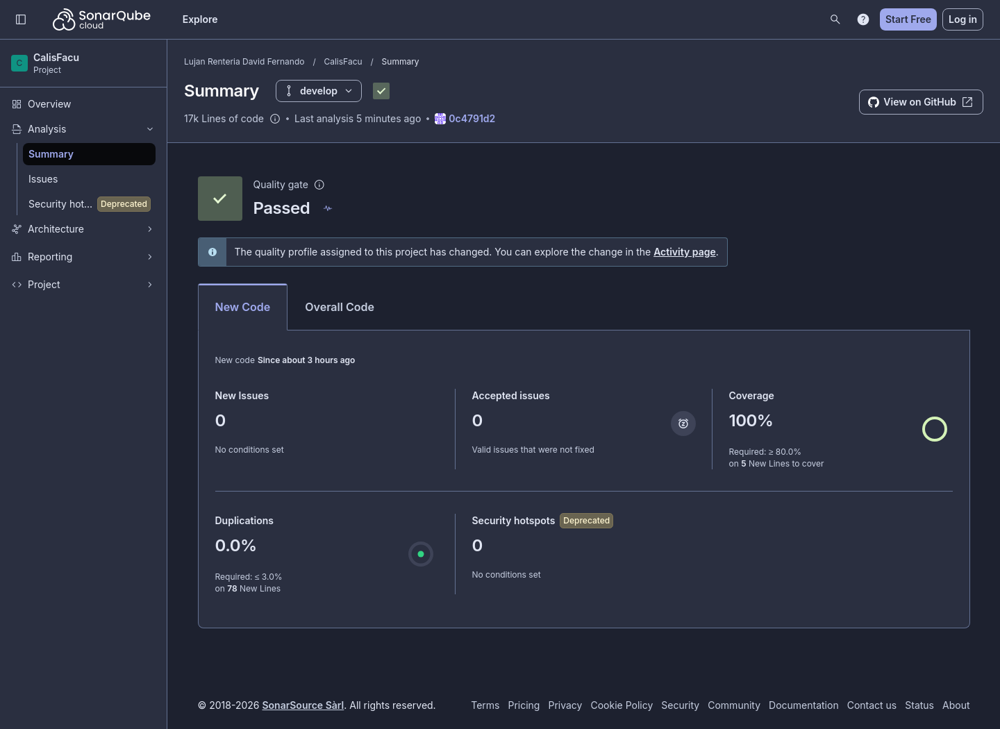

_Figura 21. Quality Gate "Passed" en develop: código nuevo con 100 % de cobertura y 0,0 % de duplicación._

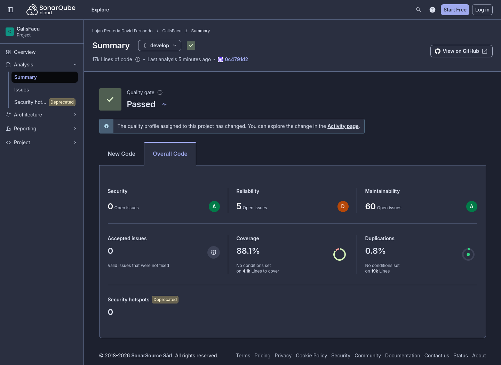

_Figura 22. Código total: 17 mil líneas, seguridad A, 88,1 % de cobertura y 0,8 % de duplicación. Observación: la
confiabilidad del código total es D por 5 incidencias anteriores al sprint; el gate solo evalúa el código nuevo._

### 8.2 Revisión contra el OWASP Top 10

Combina OWASP ZAP contra staging con la revisión del código y pruebas manuales (acta
`docs/actas/revision-owasp-sprint3.md`). Resultado: 0 fallas de ZAP antes y después; dos hallazgos medios corregidos (H1 cabeceras de la
API, H2 CSP de la web), dos registrados como defectos (CAL-003, CAL-004) y uno aceptado.

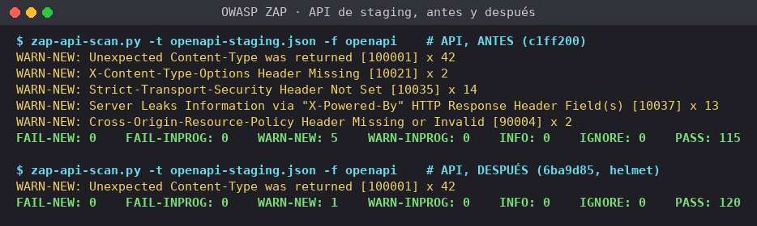

_Figura 23. OWASP ZAP sobre la API (54 rutas de la especificación OpenAPI): antes, 5 advertencias; después de helmet,
solo "Unexpected Content-Type" (respuestas 401 a un escaneo sin sesión, esperado). 0 fallas en las dos corridas._

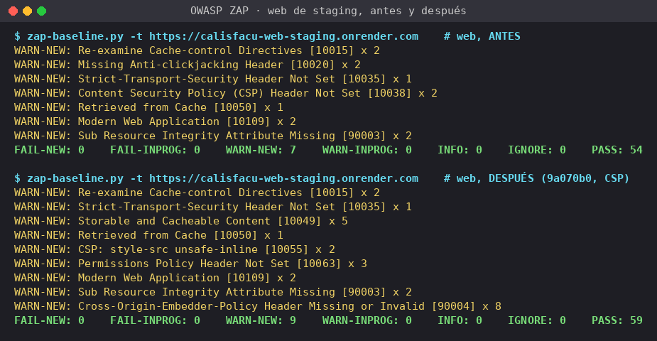

_Figura 24. OWASP ZAP sobre la web: desaparecen "CSP Header Not Set" y "Missing Anti-clickjacking Header". Con la CSP
presente ZAP revisa más a fondo; los avisos nuevos se corrigieron (Permissions-Policy) o se aceptaron con justificación
en el acta. Informes HTML en `docs/evidencias/sprint3/zap/`._

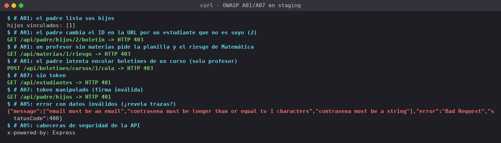

_Figura 25. A01 y A07 en staging: un padre que pide el boletín de un estudiante ajeno, un profesor sin la materia y un
padre que intenta encolar boletines reciben 403; sin token o con un token alterado, 401. En la última línea, la API
todavía anunciaba `x-powered-by: Express` (antes de corregir H1)._

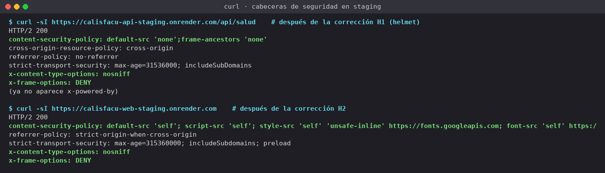

_Figura 26. Después de corregir H1 y H2: CSP, HSTS, nosniff y X-Frame-Options en la API y en la web; sin
`x-powered-by`._

## 9. El sistema desplegado en staging

Pantallas de las historias del Sprint 3 en `calisfacu-web-staging.onrender.com`, recorridas con Chromium con la CSP
activa y sin violaciones ni errores de consola.

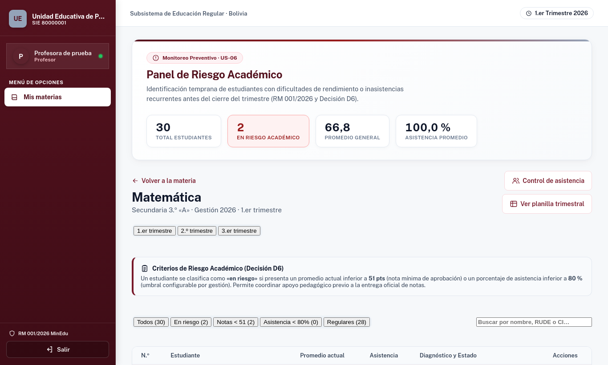

_Figura 27. US-06: panel de riesgo académico de Matemática (2 de 30 estudiantes en riesgo según D6)._

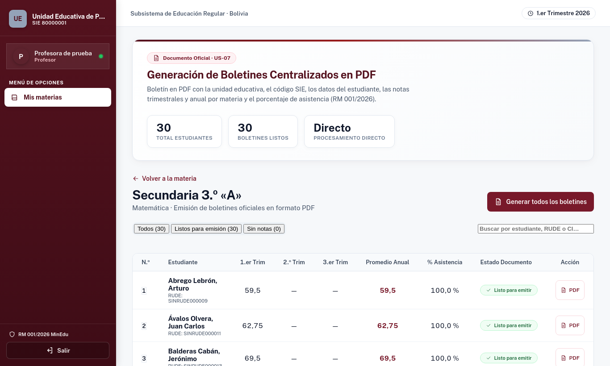

_Figura 28. US-07: generación de boletines del curso; la cola de BullMQ procesó los 30 boletines de 3.º «A» en
staging._

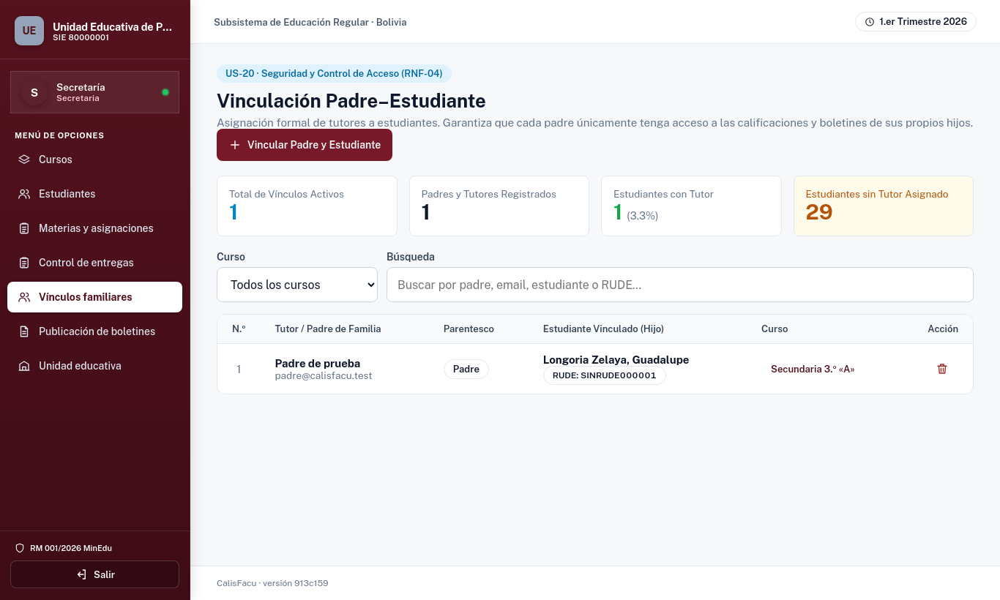

_Figura 29a. US-20: vínculos padre–estudiante (secretaría)._

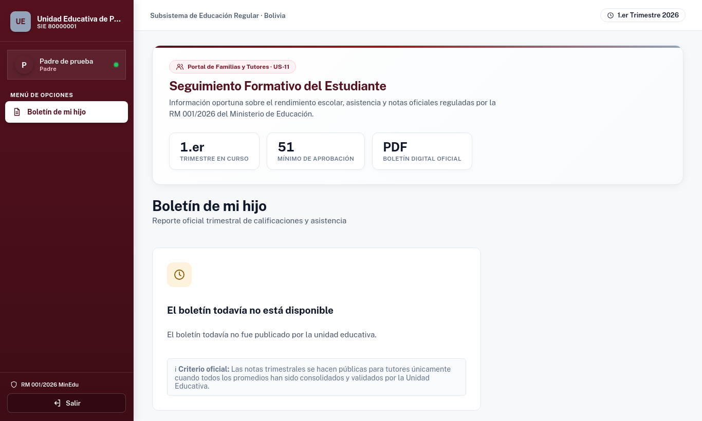

_Figura 29b. US-11: el padre no ve el boletín hasta que la unidad educativa lo publica (D20)._

## 10. Monitoreo, respaldos y defectos

### 10.1 Disponibilidad (M13)

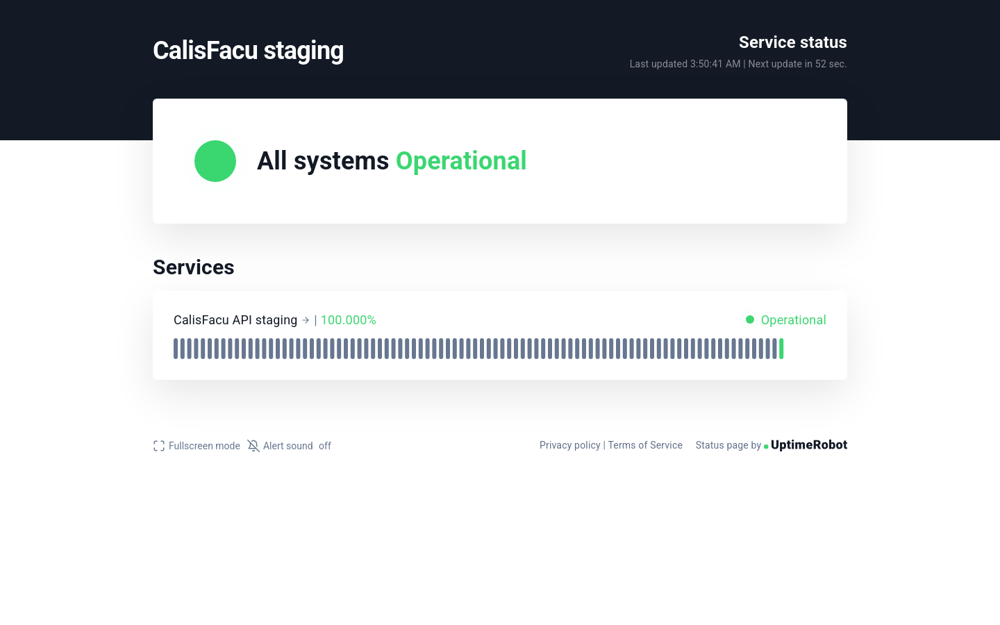

_Figura 30. UptimeRobot consulta `/api/salud` de staging cada 5 minutos y avisa por correo; 100 % desde su creación._

### 10.2 Respaldos y restauración (M14)

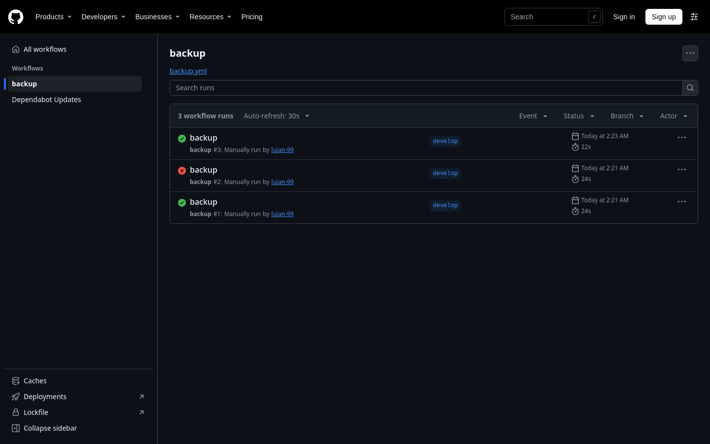

_Figura 31. Workflow `backup`: respaldo diario a las 03:00 y prueba de restauración cada viernes. El run #2 es el
defecto CAL-002, corregido en el #3._

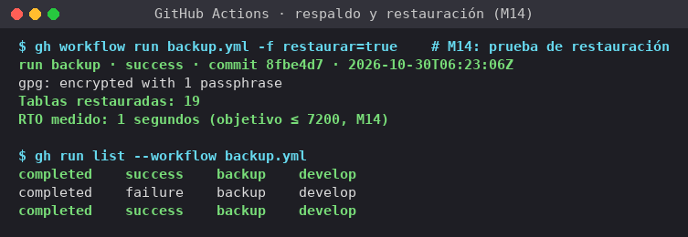

_Figura 32. Restauración del respaldo cifrado en una base vacía: 19 tablas, RTO de 1 s (objetivo ≤ 2 h)._

### 10.3 Gestión de defectos (SQAP, Sección 8)

| Defecto | Descripción                                                       | Severidad | Estado                                     |
| ------- | ----------------------------------------------------------------- | --------- | ------------------------------------------ |
| CAL-001 | La API de staging no arrancaba en Render (falta `bullmq`)         | S1 · P1   | Resuelto; postmortem y prueba de regresión |
| CAL-002 | La prueba de restauración fallaba con el rol `postgres` de Render | S2 · P1   | Resuelto                                   |
| CAL-003 | El inicio de sesión no limita peticiones por IP (OWASP H3)        | S3 · P2   | Nuevo (Sprint 4)                           |
| CAL-004 | Mensajes de validación en inglés (OWASP H4)                       | S4 · P3   | Nuevo                                      |

CAL-001 y CAL-002 comparten la causa raíz (automatizaciones que fallaban sin que nadie lo notara), por eso se registró
el riesgo R15 en el SQAP.

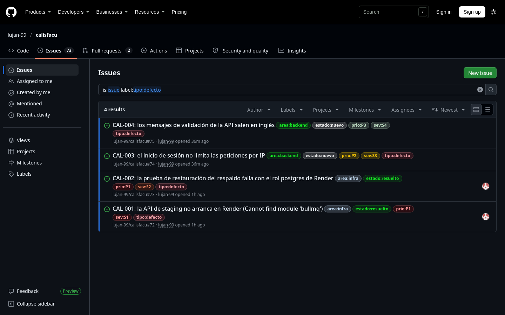

_Figura 33. Defectos registrados con el formulario y las etiquetas de severidad y prioridad del SQAP._

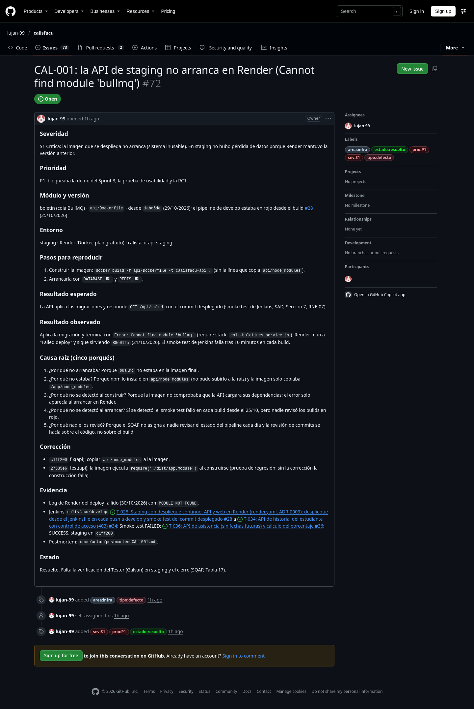

_Figura 34. CAL-001 con pasos, resultado esperado y observado, cinco porqués, corrección y evidencia._

### 10.4 Dependencias (Dependabot)

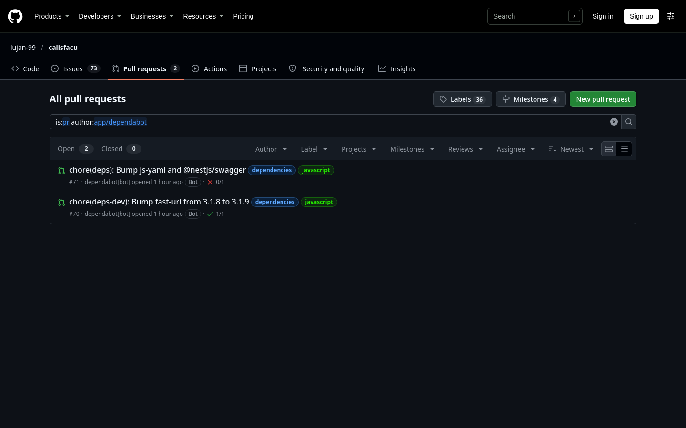

_Figura 35. Dependabot activo desde que develop es la rama por defecto: abrió sus primeros PR de actualización._

## 11. Cambios al plan durante el sprint

El SQAP pasó a la versión 1.2 (historial en su Sección 16): `familias` como quinto módulo crítico; la matriz apunta a las
etapas reales del Jenkinsfile; pdfkit y helmet en las dependencias; Anexo F cerrado con las decisiones D1 a D20 y los
datos del cliente; Quality Gate "Sonar way"; develop como rama por defecto, rulesets y respaldos de staging hasta que
exista producción; riesgo R15.

## 12. Pendientes para cerrar el sprint

| Pendiente                                                           | Responsable          | Bloquea                              |
| ------------------------------------------------------------------- | -------------------- | ------------------------------------ |
| Prueba de usabilidad con 5 profesores y SUS (T-054)                 | Galvan               | M11 y M12                            |
| Demo con la directora y la profesora; acta `revision-sprint3`       | Lujan y Galvan       | Aceptación de las historias          |
| Auditoría de desarrollo (T-055) y verificación de CAL-001 y CAL-002 | Galvan               | Cierre del sprint                    |
| Firma del acta de conformidad de cálculo (13 casos)                 | Cliente              | M01 "tabla firmada"                  |
| Firmas de las actas del sprint, OWASP y postmortem                  | Lujan, Galvan        | Indicador "Asignado e independiente" |
| Inspecciones Fagan del SRS y del SAD                                | Galvan y otro equipo | Sección 6                            |
| La base gratuita de staging vence el 12/11/2026 (R10)               | Lujan                | Staging y respaldos                  |
