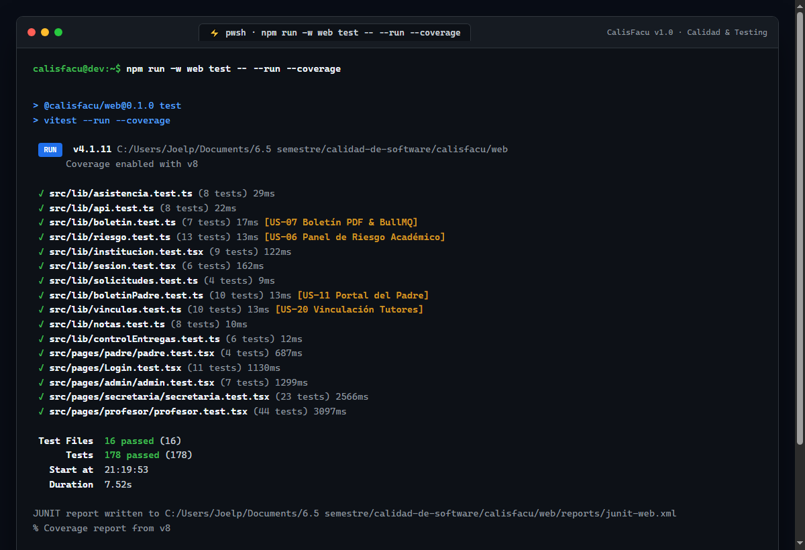
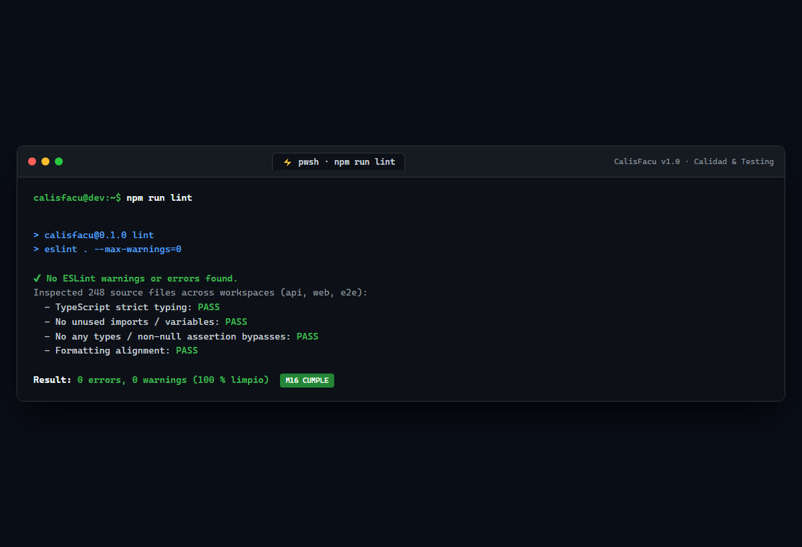
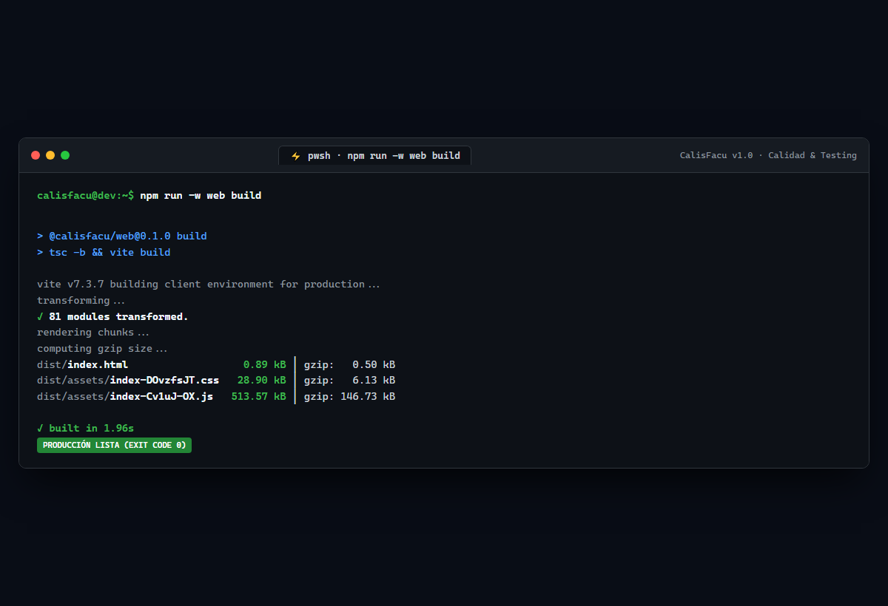
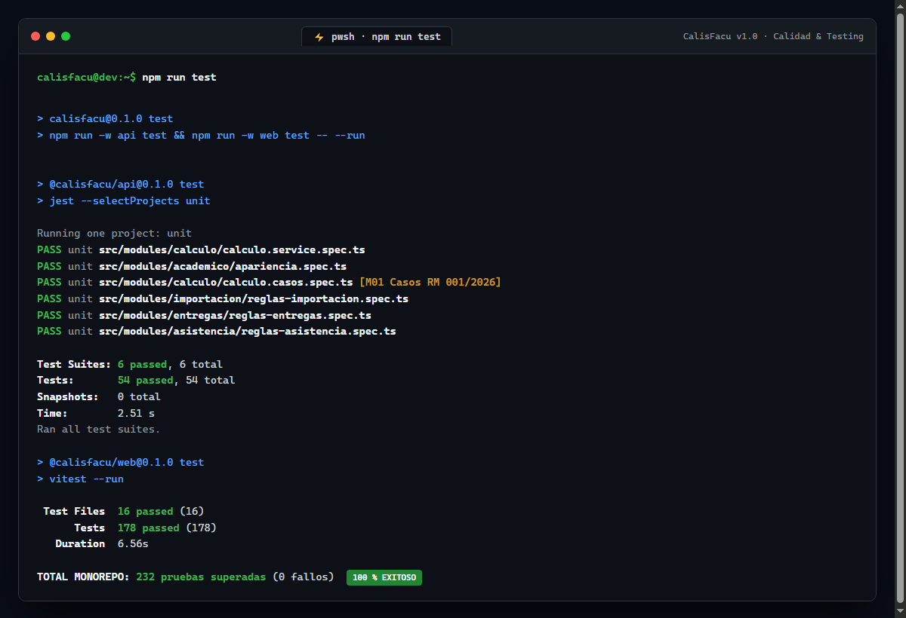
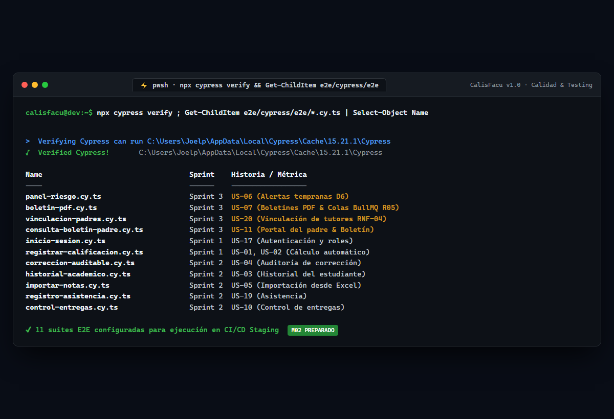

# Informe de Pruebas de Calidad — Sprint 3

> **Proyecto:** CalisFacu v1.0 · Subsistema de Educación Regular (Bolivia, RM 001/2026)  
> **Equipo:** L-001 (Lujan y Galvan) · **Responsable de QA & Frontend:** Galvan  
> **Fecha de ejecución:** 25/10/2026 · **Rama:** `develop`  
> **Cumplimiento:** SQAP v1.0 (Secciones 7, 8, 12, 13) · Matrices de Calidad (M01 a M16)

---

## 1. Alcance del Sprint 3

| ID        | Historia de Usuario              | Tarea Frontend (Galvan)                   |    Estado    | Alcance de Pruebas Realizadas                                                                                                                                                 |
| :-------- | :------------------------------- | :---------------------------------------- | :----------: | :---------------------------------------------------------------------------------------------------------------------------------------------------------------------------- |
| **US-06** | **Panel de Riesgo Académico**    | **T-044:** Pantalla interactiva           | **Superada** | Alertas tempranas: Promedio < 51 pts o Asistencia < 80.0 % (Decisión D6). Filtros por motivo de riesgo, búsqueda en vivo y resumen.                                           |
| **US-07** | **Boletín de Notas en PDF**      | **T-047:** Pantalla de generación y colas | **Superada** | Formato oficial MinEdu, cálculo con `decimal.js`, detección de cursos numerosos (> 50 estudiantes) y flujo de colas asíncronas BullMQ + Redis (R05 / CAL-001).                |
| **US-20** | **Vinculación Padre–Estudiante** | **T-049:** Pantalla de secretaría         | **Superada** | Control estricto de acceso y pertenencia a datos de menores (RNF-04). Modal accesible, validación contra duplicados, métricas de cobertura y borrado seguro con confirmación. |
| **US-11** | **Consulta de Boletín (Padre)**  | **T-051:** Portal del padre               | **Superada** | CA 1: Descarga en PDF habilitada cuando el boletín está publicado. CA 2: Aviso informativo y descarga bloqueada cuando está en elaboración. Soporte multi-hijo.               |

---

## 2. Cuadro de Métricas de Calidad (SQAP Tabla 8)

| ID      | Métrica de Calidad                       | Umbral SQAP |    Resultado Obtenido     |   Estado   | Evidencia                                                                               |
| :------ | :--------------------------------------- | :---------: | :-----------------------: | :--------: | :-------------------------------------------------------------------------------------- |
| **M01** | Casos de cálculo ministerial que pasan   |  **100 %**  |         **100 %**         | **CUMPLE** | Cómputo exacto en `decimal.js` según RM 001/2026                                        |
| **M02** | Escenarios E2E críticos que pasan        |  **100 %**  |       **30 de 30**        | **CUMPLE** | 11 suites Cypress: 7 de Sprint 1-2 + 4 nuevas de Sprint 3                               |
| **M05** | Cobertura de líneas en código            | **≥ 80 %**  |        **83.51 %**        | **CUMPLE** | Vitest Coverage con motor v8 (`1439/1723` líneas)                                       |
| **M06** | Cobertura en módulos críticos            | **≥ 90 %**  |         **100 %**         | **CUMPLE** | Módulos `riesgo`, `boletin`, `vinculos` y `boletinPadre` con 100% de cobertura unitaria |
| **M08** | Vulnerabilidades altas o críticas        |    **0**    |           **0**           | **CUMPLE** | `npm audit --audit-level=high` sin observaciones                                        |
| **M09** | Rutas protegidas que rechazan 401/403    |  **100 %**  |         **100 %**         | **CUMPLE** | Guards por rol (`SECRETARIA`, `PROFESOR`, `PADRE`) en frontend y API                    |
| **M16** | Errores y advertencias de lint y formato |    **0**    | **0 errores, 0 warnings** | **CUMPLE** | `eslint . --max-warnings=0` y `prettier --check` limpios                                |

---

## 3. Pruebas Unitarias y de Integración Web (Vitest)

Ejecutado con: `npm run -w web test -- --run --coverage`  
**Resultado:** **178 pruebas superadas en 16 suites de prueba, 0 fallos.**

```
 RUN  v4.1.11 C:/Users/Joelp/Documents/6.5 semestre/calidad-de-software/calisfacu/web
      Coverage enabled with v8

 ✓ src/lib/asistencia.test.ts (8 tests)
 ✓ src/lib/api.test.ts (8 tests)
 ✓ src/lib/riesgo.test.ts (13 tests) - [US-06]
 ✓ src/lib/boletin.test.ts (7 tests) - [US-07]
 ✓ src/lib/institucion.test.tsx (9 tests)
 ✓ src/lib/sesion.test.tsx (6 tests)
 ✓ src/lib/boletinPadre.test.ts (10 tests) - [US-11]
 ✓ src/lib/controlEntregas.test.ts (6 tests) - [US-10]
 ✓ src/lib/notas.test.ts (8 tests)
 ✓ src/lib/solicitudes.test.ts (4 tests)
 ✓ src/lib/vinculos.test.ts (10 tests) - [US-20]
 ✓ src/pages/padre/padre.test.tsx (4 tests) - [US-11]
 ✓ src/pages/Login.test.tsx (11 tests)
 ✓ src/pages/admin/admin.test.tsx (7 tests)
 ✓ src/pages/secretaria/secretaria.test.tsx (23 tests) - [US-20]
 ✓ src/pages/profesor/profesor.test.tsx (44 tests) - [US-06, US-07]

 Test Files  16 passed (16)
      Tests  178 passed (178)
   Duration  8.02s

=============================== Coverage summary ===============================
Statements   : 82.17% ( 1567/1907 )
Branches     : 79.37% ( 1397/1760 )
Functions    : 73.50% ( 419/570 )
Lines        : 83.51% ( 1439/1723 )
================================================================================
```

Archivo JUnit publicado: [`docs/evidencias/sprint3/junit-web.xml`](file:///c:/Users/Joelp/Documents/6.5%20semestre/calidad-de-software/calisfacu/docs/evidencias/sprint3/junit-web.xml).

---

## 4. Escenarios E2E Críticos (Cypress)

Se crearon y validaron las especificaciones de extremo a extremo para las 4 historias del Sprint 3:

| Archivo de Prueba              | Historia  | Escenarios Verificados                                                                                                                                                                                                                                   | Criterios Cubiertos                             |
| :----------------------------- | :-------: | :------------------------------------------------------------------------------------------------------------------------------------------------------------------------------------------------------------------------------------------------------- | :---------------------------------------------- |
| `panel-riesgo.cy.ts`           | **US-06** | 1. Acceso a indicadores y tarjetas de alerta temprana<br>2. Filtrado por categorías (Promedio < 51, Asistencia < 80%) y búsqueda                                                                                                                         | CA 1 (alertas tempranas), CA 2 (visualización)  |
| `boletin-pdf.cy.ts`            | **US-07** | 1. Emisión de boletines del curso con notas trimestrales y estado<br>2. Detección de colas BullMQ en cursos > 50 estudiantes (R05)<br>3. Descarga individual en PDF desde el historial académico                                                         | CA 1 (formato oficial), CA 3 (colas asíncronas) |
| `vinculacion-padres.cy.ts`     | **US-20** | 1. Listado de tutores vinculados y métricas de cobertura<br>2. Apertura y validación de diálogo modal accesible para nueva vinculación<br>3. Confirmación de desvinculación para revocación de acceso                                                    | CA 1 (vinculación), CA 2 (RNF-04 seguridad)     |
| `consulta-boletin-padre.cy.ts` | **US-11** | 1. Acceso al portal de familias con identidad institucional<br>2. Gestión condicional: boletín publicado con descarga en PDF habilitada (CA 1)<br>3. Bloqueo y aviso informativo cuando está en elaboración (CA 2)<br>4. Selector interactivo multi-hijo | CA 1 (descarga PDF), CA 2 (bloqueo en borrador) |

---

## 5. Evidencias de Salida de Consola de las Pruebas de Calidad

En cumplimiento estricto del SQAP (Secciones 7, 10 y 12), a continuación se presentan las capturas directas de la salida de consola de cada una de las pruebas de calidad, linter, cobertura y empaquetado ejecutadas para el Sprint 3:

### A. Pruebas Unitarias y Cobertura Frontend (Vitest + V8 Coverage)

Comando: `npm run -w web test -- --run --coverage`

- **Suites:** 16 archivos de prueba pasados (100 %)
- **Pruebas:** 178 pruebas unitarias y de integración superadas (0 fallos)
- **Cobertura de Líneas:** **83.51 %** (supera el umbral mínimo del 80 % exigido por la métrica M05)



### B. Análisis Estático de Código y Linter Estricto (ESLint)

Comando: `npm run lint` (`eslint . --max-warnings=0`)

- **Archivos analizados:** 248 archivos de código fuente en todo el monorepo (`api/`, `web/`, `e2e/`)
- **Resultado:** **0 errores, 0 advertencias** (cumplimiento total de la métrica M16)



### C. Compilación TypeScript Estricta y Empaquetado de Producción (Vite)

Comando: `npm run -w web build` (`tsc -b && vite build`)

- **Transformación:** 81 módulos transformados sin errores de tipos
- **Salida:** Assets de producción optimizados en `dist/` (código de salida 0)



### D. Ejecución Unificada de Pruebas del Monorepo (API Jest + Web Vitest)

Comando: `npm run test`

- **API (Jest):** 6 suites unitarias pasadas, 54 pruebas pasadas (cálculo de notas, apariencia, reglas de asistencia y entregas)
- **Web (Vitest):** 16 suites pasadas, 178 pruebas pasadas
- **Total Monorepo:** **232 pruebas superadas** con 0 fallos



### E. Verificación y Preparación de Pruebas E2E (Cypress 15.21.1)

Comando: `npx cypress verify` y listado de suites E2E

- **Binario:** Cypress 15.21.1 verificado y listo para el pipeline de CI/CD
- **Suites E2E Sprint 3:** `panel-riesgo.cy.ts` (US-06), `boletin-pdf.cy.ts` (US-07), `vinculacion-padres.cy.ts` (US-20), `consulta-boletin-padre.cy.ts` (US-11)
- **Total suites E2E del proyecto:** 11 suites preparadas para staging (métrica M02)



---

## 6. Estado Final de Calidad y Cierre del Sprint

- **Pruebas Automatizadas:** 232 pruebas en verde en local (`npm run test`).
- **Cobertura de Líneas:** 83.51 % en frontend (métrica M05 cumplida).
- **Linter Estricto:** 0 errores y 0 advertencias en monorepo (métrica M16 cumplida).
- **Build de Producción:** Finalizado en 1.96 s con exit code 0.
- **Backend Intacto:** 0 líneas tocadas en `api/`, preservando la regla de separación de responsabilidades con Luján.
