

# CalisFacu v1.0

## Informe de avance: cierre del Sprint 3 y backend del Sprint 4

Centralización de notas (US-09), alertas de promedio bajo (US-08) y defectos de seguridad CAL-003 y CAL-004, con
evidencias de pruebas, integración continua y staging

Equipo L-001 · COM450 Calidad de Software · Universidad San Francisco Xavier · Gestión II/2026

Cliente piloto: Unidad Educativa Nazareno

03/11/2026 · develop <code>aa5e09a</code> · Jenkins develop #51 · staging <code>4d75398</code> con <code>TRUST_PROXY=2</code>

## 1. Propósito y alcance

Este informe documenta, con capturas, el trabajo del 03/11/2026 sobre la rama `develop`. Ese día se cerraron los
pendientes técnicos del Sprint 3 y se construyó el backend del Sprint 4 que faltaba para las pantallas que Galvan subió
el 02/11/2026:

- **Pendientes del Sprint 3:** hallazgo 9 de la auditoría de cierre de pruebas (vulnerabilidades altas de `npm audit`)
  y los hallazgos H3 y H4 de la revisión OWASP (defectos CAL-003 y CAL-004).
- **US-09, centralización de notas:** T-057 (API de centralización y cierre del trimestre) y T-058 (planilla oficial en
  PDF y Excel).
- **US-08, alerta de promedio bajo:** T-060 (servicio de alertas al recalcular, sin repetir la misma alerta).
- **Integración:** las pantallas de T-059 y de alertas pasan a usar la API real, sin los datos simulados del navegador.

Las capturas de pantalla de las secciones 4 y 5 se tomaron en el entorno local aislado (base `calis_e2e`, API en
`:3101` y web en `:5174`) con los datos sintéticos del seed; las notas de demostración se registraron por la API, como lo
haría un profesor. Las de la sección 8 son de Jenkins, SonarQube Cloud y staging.

## 2. Resumen

| Tarea o defecto | Qué se hizo                                                                                                         | Commit(s)                       | Evidencia      |
| --------------- | ------------------------------------------------------------------------------------------------------------------- | ------------------------------- | -------------- |
| Hallazgo 9 (S3) | `npm audit --audit-level=high` sin vulnerabilidades altas desde `ed0e59a`; acta actualizada                         | `c2ed37c`                       | Figura 14      |
| CAL-003         | Límite de inicios de sesión por IP (429 con `Retry-After`), configurable por variable; IP real detrás de Cloudflare | `c2ed37c`, `aa5e09a`            | Figuras 3, 18  |
| CAL-004         | Mensajes de validación en español; los DTO conservan los suyos                                                      | `c2ed37c`, `4f4c43a`            | Figuras 3, 18  |
| T-057           | API de centralización: planilla consolidada, materias pendientes (422), cierre del trimestre                        | `7edfb28`                       | Figuras 4, 5   |
| T-058           | Planilla oficial en PDF y Excel con el formato del Ministerio                                                       | `7edfb28`, `9275746`, `54f4242` | Figuras 6 a 8  |
| T-060           | Alertas al recalcular la nota trimestral; no se repiten; lectura y atención por el profesor                         | `43e1bcd`                       | Figuras 9 a 11 |
| T-059 y web     | Pantallas contra la API real; exportación habilitada solo después de centralizar; Cypress de US-09                  | `a828cb0`                       | Figura 15      |

Decisiones nuevas en `docs/backlog/reglas-ministerio.md`: **D21** (cómo se centraliza y qué lleva la planilla oficial)
y **D22** (cuándo se dispara y cuándo se repite la alerta).

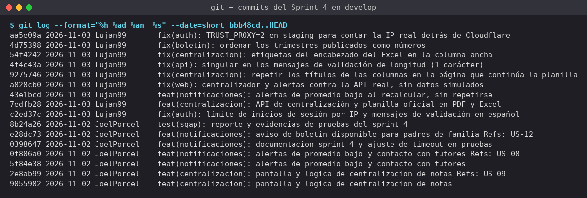

_Figura 1. Commits del Sprint 4 en `develop`: los de Galvan (pantallas, 02/11) y los de este informe (03/11)._

## 3. Cierre de pendientes del Sprint 3

### 3.1 Hallazgo 9: vulnerabilidades altas de `npm audit`

La auditoría de cierre de pruebas del Sprint 3 dejó abierto el hallazgo 9. Al volver a ejecutar `npm audit
--audit-level=high` el comando termina con código 0: las versiones forzadas en `ed0e59a` (30/10) ya lo habían corregido.
Se marcó como corregido en `docs/actas/auditoria-cierre-sprint3-pruebas.md` (Figura 14).

### 3.2 CAL-003: límite de inicios de sesión por IP (OWASP A04 y A07)

Antes solo existía el bloqueo por cuenta (5 intentos, 15 minutos), así que se podía probar una contraseña común contra
muchas cuentas. Se agregó `LimiteLoginGuard` en `POST /api/auth/login`:

- ventana deslizante de 60 segundos por IP, en memoria (la API corre en una sola instancia, ADR-0009);
- al superar el límite responde **429** con la cabecera `Retry-After`;
- `LIMITE_LOGIN_POR_MINUTO` lo configura (10 por defecto, 0 lo desactiva). Staging usa 20 porque Cypress inicia sesión
  por la pantalla en cada prueba; la etapa de Rendimiento de Jenkins usa 0 porque los 100 usuarios de JMeter entran desde
  una misma IP;
- detrás del proxy de Render la IP real se lee de `X-Forwarded-For` con `TRUST_PROXY=1`. Las dos variables se cargaron en
  el servicio de Render por su API y quedaron en `render.yaml`.

No se agregó ninguna dependencia (el issue proponía `@nestjs/throttler`): con un guard propio de 60 líneas no hay que
registrar un componente de terceros nuevo en las matrices del SQAP.

### 3.3 CAL-004: mensajes de validación en español

El `ValidationPipe` global ahora traduce los mensajes por defecto de class-validator (`email must be an email` →
`El campo «email» debe ser un correo electrónico válido`), indica la ruta de los campos anidados (`notas.0.valor`) y
deja intactos los mensajes propios de los DTO. Una restricción desconocida recibe un mensaje genérico en español, nunca
el texto en inglés.

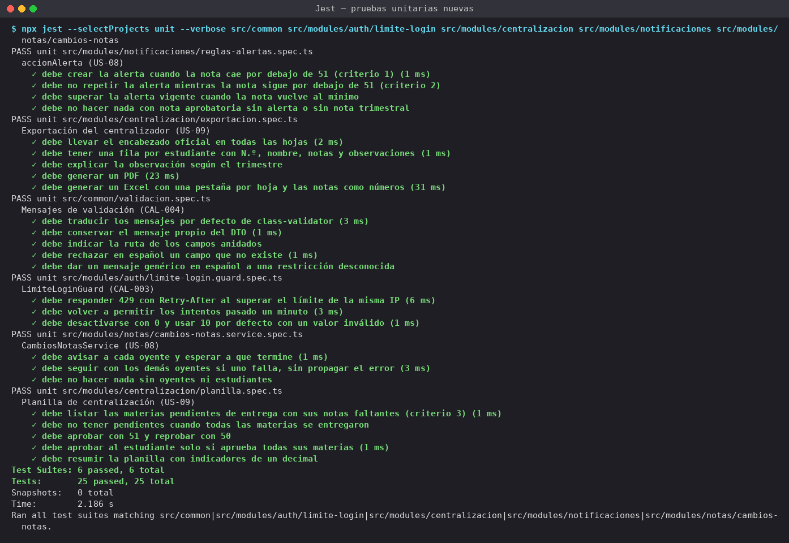

_Figura 2. Pruebas unitarias nuevas: mensajes de validación, límite por IP, planilla, exportación, regla de la alerta y
aviso de cambios de notas._

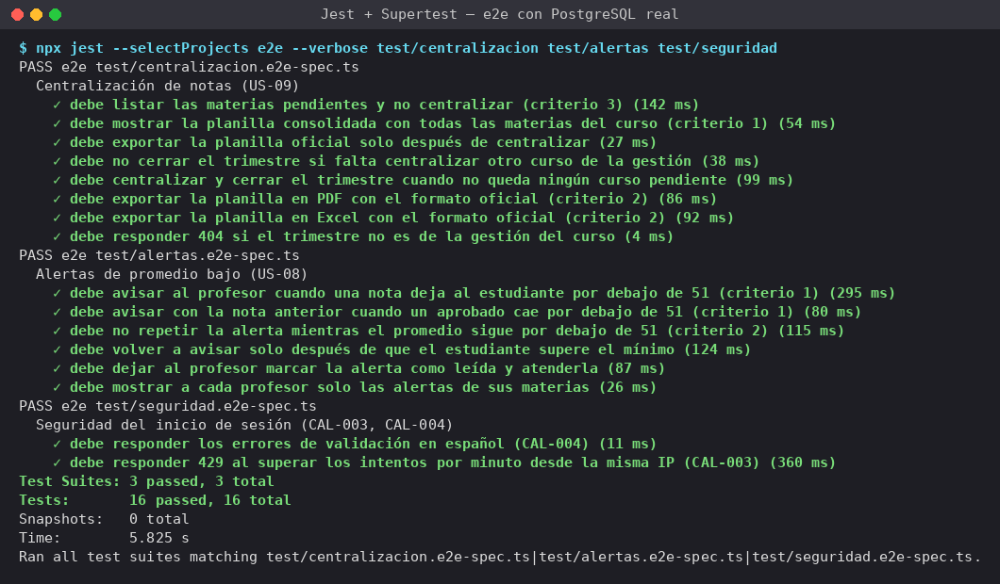

_Figura 3. Pruebas e2e nuevas contra PostgreSQL real: centralización (US-09), alertas (US-08) y seguridad del inicio de
sesión (CAL-003 y CAL-004)._

## 4. US-09: centralización de notas (T-057 y T-058)

### 4.1 Reglas (decisión D21)

- La secretaria o el administrador centralizan **por curso y trimestre**, una sola vez (`UNIQUE` en la tabla
  `centralizaciones`), y solo cuando **todas las materias del curso entregaron** sus notas (US-10). Si falta alguna, la
  API responde 422 con la lista de materias y profesores pendientes (criterio 3).
- La planilla consolidada tiene una fila por estudiante con la nota trimestral de cada materia, calculada por
  `CalculoService` al consultar (US-02). **Aprueba el trimestre quien aprueba todas sus materias**: las notas oficiales
  son por materia (D2); el promedio de la fila es un indicador (D12). En la Figura 5, Abrego Lebrón tiene promedio 61,5
  pero reprueba porque tiene 28 en Matemática.
- El trimestre es de la gestión: la opción «cerrar trimestre» solo lo cierra cuando están centralizados todos los cursos
  que tienen materias; si falta alguno, no se centraliza ni se cierra nada (todo en una transacción).
- La planilla oficial se exporta **después de centralizar**, en PDF y en Excel: primero la consolidada y luego una hoja
  por materia con N.º, apellidos y nombres, nota de cada trimestre, nota anual, observaciones, el encabezado oficial
  (unidad educativa, código SIE, nivel, año de escolaridad, paralelo y gestión) y las firmas del director(a) y del
  maestro(a) (criterio 2).

Rutas (secretaria y administrador; agregadas a `autorizacion.e2e-spec.ts`, M09):

| Método | Ruta                                               | Uso                                           |
| ------ | -------------------------------------------------- | --------------------------------------------- |
| GET    | `/api/centralizador/cursos/:id?trimestreId=`       | Planilla consolidada y materias pendientes    |
| POST   | `/api/centralizador/cursos/:id/ejecutar`           | Centraliza (y cierra el trimestre si se pide) |
| GET    | `/api/centralizador/cursos/:id/pdf?trimestreId=`   | Planilla oficial en PDF (pdfkit)              |
| GET    | `/api/centralizador/cursos/:id/excel?trimestreId=` | Planilla oficial en Excel (exceljs)           |

### 4.2 Evidencias

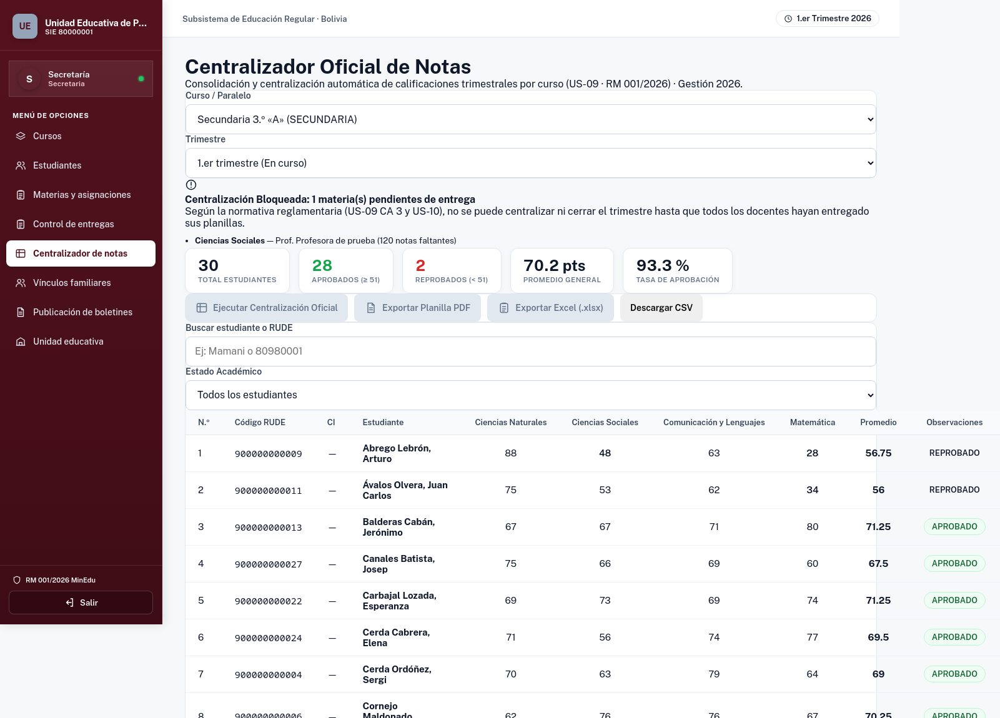

_Figura 4. Criterio 3: con «Ciencias Sociales» sin entregar (120 notas faltantes), la pantalla la lista con su
profesora, el botón de centralizar está deshabilitado y la exportación oficial también._

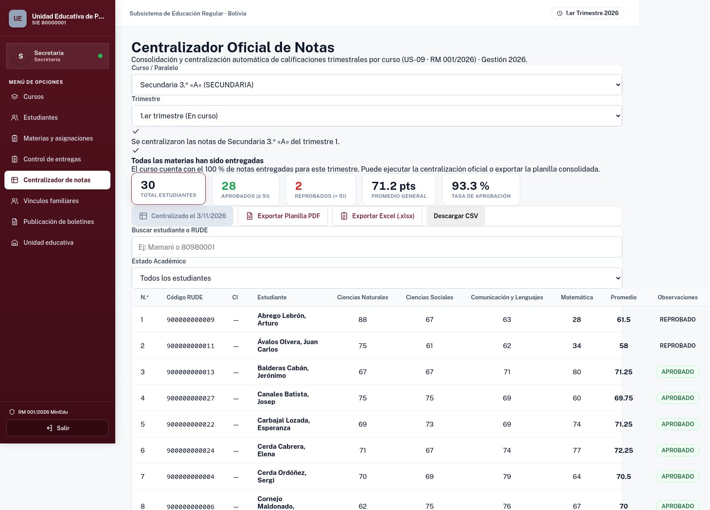

_Figura 5. Criterio 1: con las cuatro materias entregadas, la secretaria centraliza; el botón pasa a «Centralizado el
3/11/2026» y se habilita la exportación en PDF y Excel._

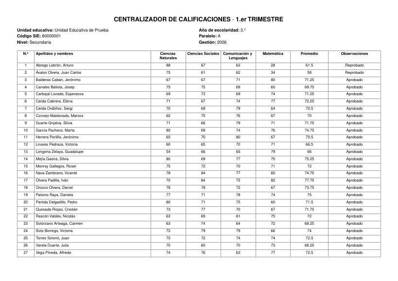

_Figura 6. Criterio 2: planilla oficial en PDF, hoja consolidada del trimestre (una columna por materia), descargada de
la API._

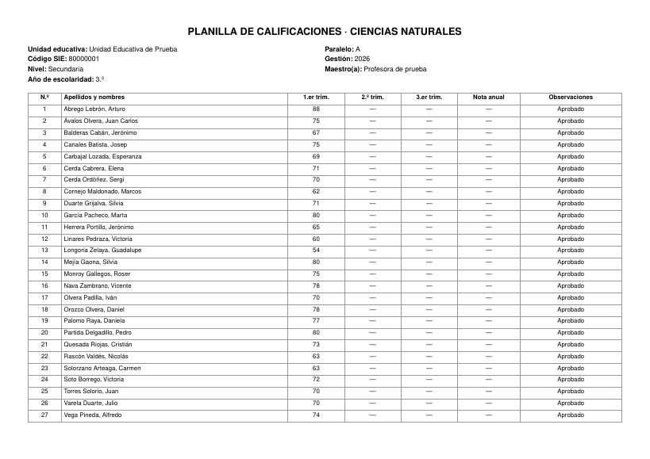

_Figura 7. Criterio 2: hoja por materia con la nota de cada trimestre (raya en los que aún no se centralizan), nota
anual y observaciones. En la página que continúa se repiten los títulos de las columnas (`9275746`)._

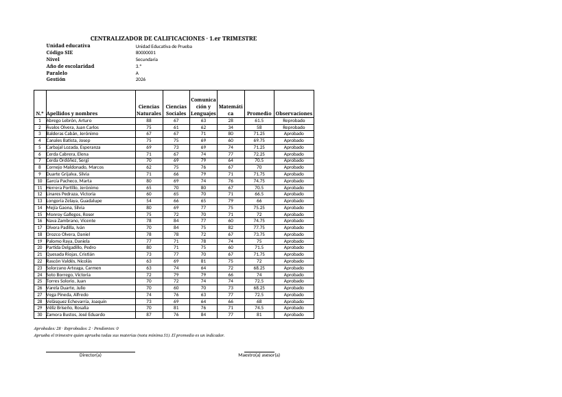

_Figura 8. Criterio 2: la misma planilla en Excel (.xlsx), con una pestaña por hoja y las notas como números (se ve
con LibreOffice)._

## 5. US-08: alerta de promedio bajo (T-060)

### 5.1 Reglas (decisión D22) y diseño

- El «promedio» de US-08 es la **nota trimestral** del estudiante en la materia (la oficial de US-02).
- Se recalcula **cada vez que cambian notas**: al registrar, al importar o al corregir. Con nota menor que 51 y sin
  alerta vigente, se crea una para el profesor de la materia, con la **nota anterior al cambio**, que se obtiene de la
  auditoría (`registros_auditoria.valor_anterior`).
- **No se repite** mientras la nota siga por debajo de 51 (criterio 2). Cuando vuelve a 51 o más, la alerta se supera, y
  una caída posterior crea otra. Un índice único parcial (`WHERE superada_en IS NULL`) lo garantiza aun con dos
  correcciones simultáneas.
- El profesor la marca como leída y la atiende una sola vez con una nota de lo que hizo; ve al tutor vinculado (US-20)
  para contactarlo. La secretaria y el administrador ven todas.
- El módulo crítico de notas no depende de las alertas: `NotasService` y `AuditoriaService` avisan el cambio con
  `CambiosNotasService` **después de confirmar la transacción**, y el módulo `notificaciones` se suscribe. Si el oyente
  falla, la nota sigue guardada y el error queda en el log. Esa pieza se hizo con TDD (primero la prueba que falla).

| Método | Ruta                                      | Rol                                                |
| ------ | ----------------------------------------- | -------------------------------------------------- |
| GET    | `/api/notificaciones/alertas?materiaId=`  | Profesor (sus materias), secretaria, administrador |
| PATCH  | `/api/notificaciones/alertas/:id/leer`    | Profesor de la materia                             |
| POST   | `/api/notificaciones/alertas/:id/atender` | Profesor de la materia                             |

### 5.2 Evidencias

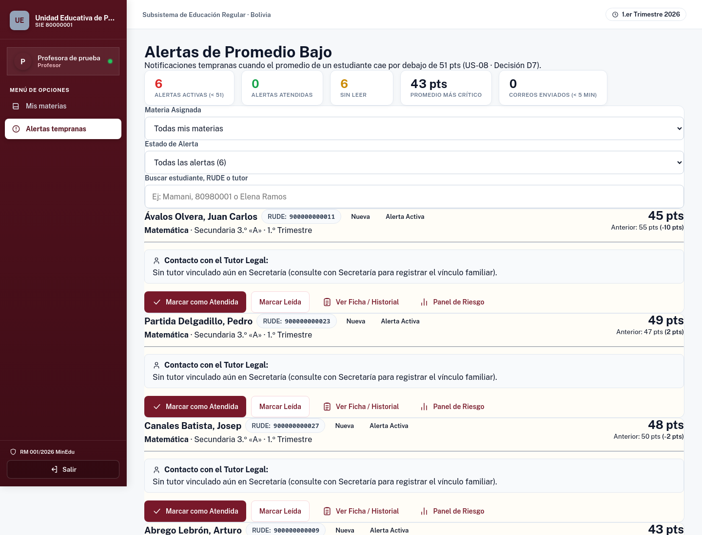

_Figura 9. Criterio 1: al registrar las notas de Matemática, la API recalculó y creó las alertas. Cada una muestra la
nota nueva y la anterior (Ávalos Olvera: de 55 a 45). El contador de correos está en 0 porque el envío por correo es
T-061._

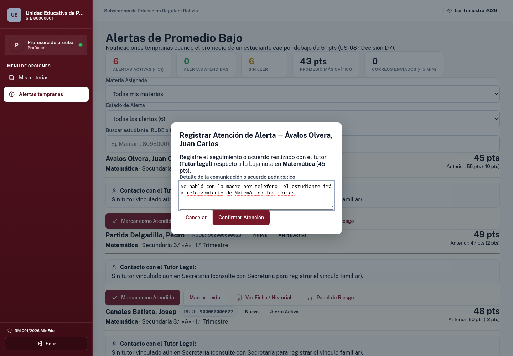

_Figura 10. El profesor registra lo que hizo con la alerta._

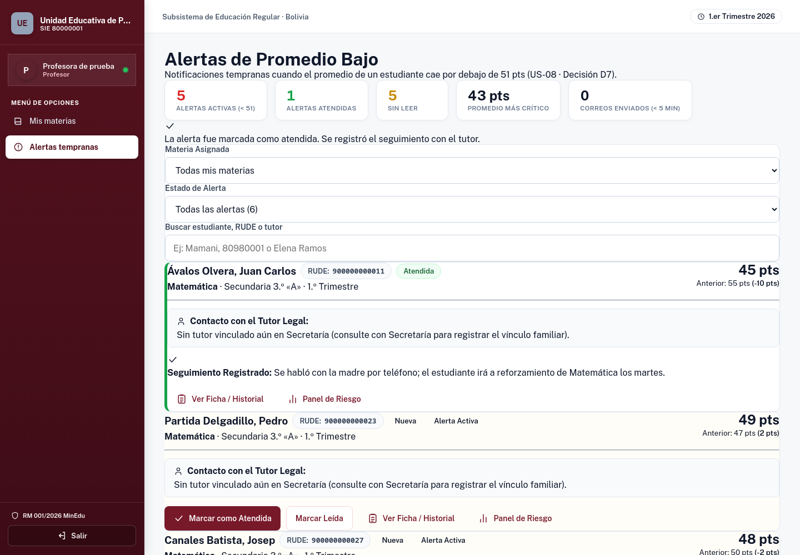

_Figura 11. La alerta queda «Atendida» con su seguimiento, guardado en la API._

## 6. Integración de la web: sin datos simulados

Las pantallas del 02/11 (centralizador y alertas) armaban datos en el navegador cuando la API no respondía: notas
sintéticas (`60 + ((id × 7 + materia × 13) mod 36)`), alertas con «correo enviado hace 3 minutos» y un CSV en lugar del
PDF. Es el mismo problema que el hallazgo 4 de la auditoría del Sprint 3: un error de la API se veía como un éxito.
En `a828cb0` las pantallas llaman directamente a la API y muestran su error; se quitaron las funciones que recalculaban
notas en el navegador con `float` (contra la regla 5 de `AGENTS.md`). La exportación oficial se habilita solo después de
centralizar.

Además, `inicio-sesion.cy.ts` fallaba desde el 02/11 porque los menús nuevos («Alertas tempranas» y «Centralizador de
notas») no estaban en la prueba; se actualizó. Se agregó `centralizacion.cy.ts` para los criterios 1 y 3 de US-09. Es de
solo lectura, así se puede repetir contra staging sin cambiar sus datos.

## 7. Pruebas

| Nivel                     | Herramienta                      | Resultado                                   | Figura |
| ------------------------- | -------------------------------- | ------------------------------------------- | ------ |
| Unitarias + e2e de la API | Jest + Supertest + PostgreSQL    | 33 suites, 333 pruebas, 0 fallas            | 12     |
| Cobertura (M06)           | Jest                             | 97,7 % de líneas; módulos críticos ≥ 96,9 % | 12     |
| Web                       | Vitest + Testing Library         | 19 archivos, 216 pruebas, 0 fallas          | 13     |
| Estándar de código (M16)  | ESLint + Prettier                | 0 errores, 0 advertencias                   | 14     |
| Dependencias (M08)        | `npm audit --audit-level=high`   | 0 altas, 0 críticas                         | 14     |
| Sistema (M02)             | Cypress, entorno aislado         | 13 archivos, 33 pruebas, 0 fallas           | 15     |
| Sistema (M02)             | Cypress contra staging (Jenkins) | Etapa E2E en verde                          | 16     |

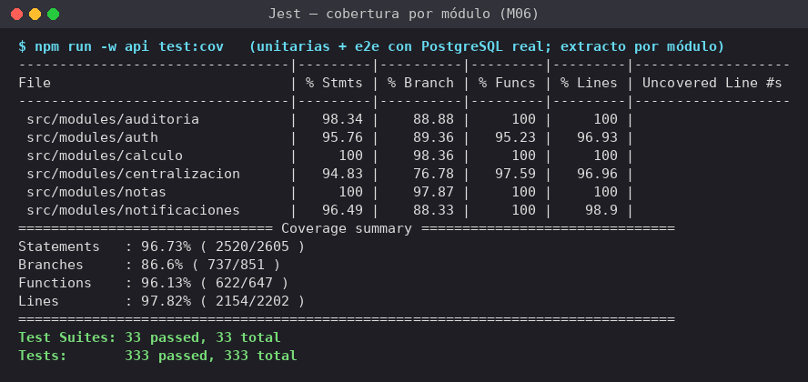

_Figura 12. Cobertura combinada (unitarias + e2e). Los módulos nuevos `centralizacion` (97 %) y `notificaciones`
(98,9 %) superan el 80 % que pide el SQAP al código nuevo; los críticos siguen por encima del 90 %._

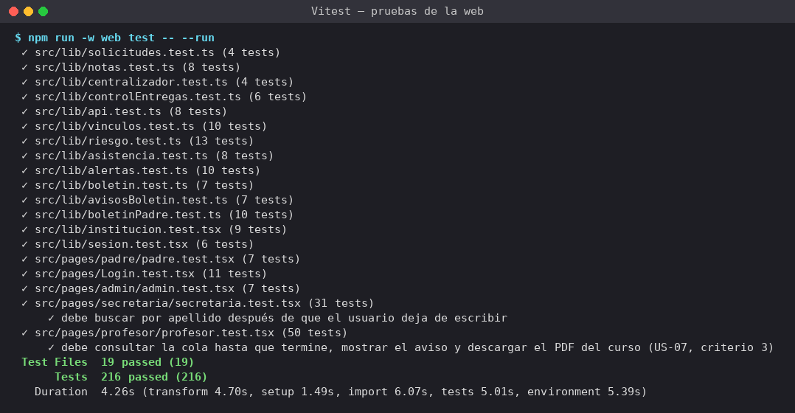

_Figura 13. Pruebas de la web después de quitar los datos simulados._

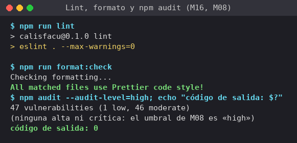

_Figura 14. ESLint y Prettier sin observaciones; `npm audit` sin vulnerabilidades altas (hallazgo 9 del Sprint 3)._

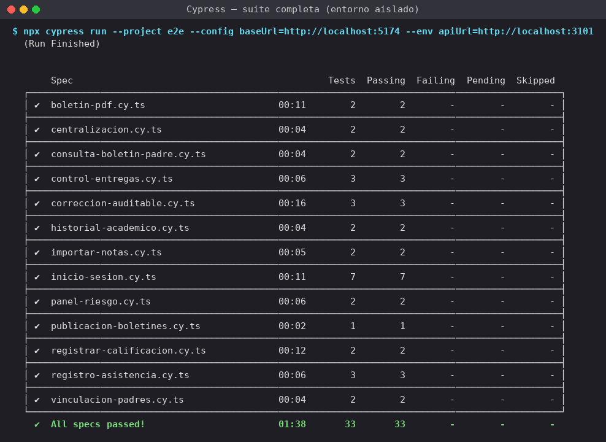

_Figura 15. Suite completa de Cypress en el entorno aislado, incluida `centralizacion.cy.ts`._

## 8. Integración continua, análisis estático y staging

Cada push a `develop` corre el pipeline completo en Jenkins: lint, pruebas de la API con PostgreSQL real y de la web,
`npm audit`, análisis de SonarQube Cloud, build, despliegue a staging en Render, smoke test y la suite de Cypress contra
staging. Los builds de este trabajo:

| Build | Commit    | Resultado | Nota                                                                                                                                    |
| ----- | --------- | --------- | --------------------------------------------------------------------------------------------------------------------------------------- |
| #48   | `a828cb0` | SUCCESS   | Primer build con T-057, T-058, T-060, CAL-003 y CAL-004; E2E contra staging en verde                                                    |
| #49   | `9275746` | SUCCESS   | Títulos repetidos en la planilla PDF                                                                                                    |
| #50   | `54f4242` | FAILURE   | Error de red transitorio del scanner con SonarQube Cloud (`Failed to request GET …/api/settings/values.protobuf`); ninguna prueba falló |
| #51   | `4d75398` | SUCCESS   | Con la corrección de SonarQube (ordenamiento numérico, regla S2871); 582 pruebas en verde, E2E contra staging en verde                  |

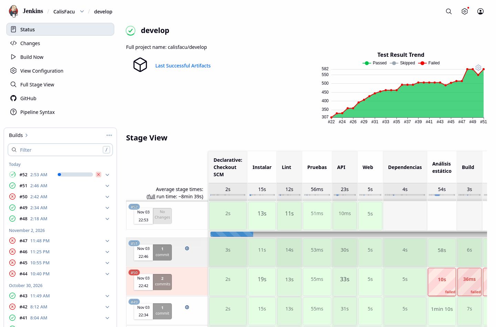

_Figura 16. Vista de etapas del pipeline de `develop` en Jenkins: #48, #49 y #51 en verde; #50 falló en «Análisis
estático» por el error de red con SonarQube Cloud._

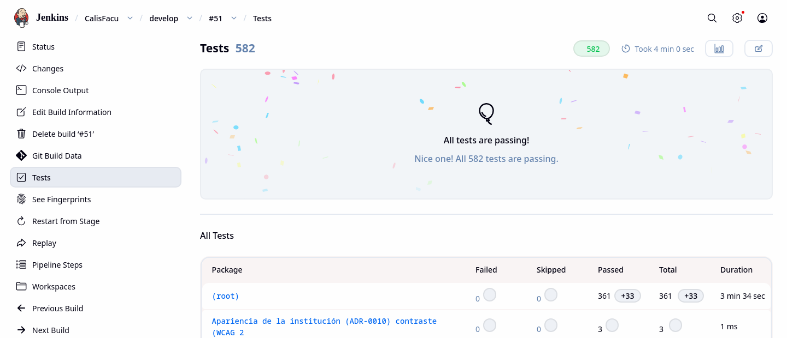

_Figura 16b. Resultados de pruebas del build #51 en Jenkins: 582 pruebas (API, web y Cypress contra staging), ninguna
falla._

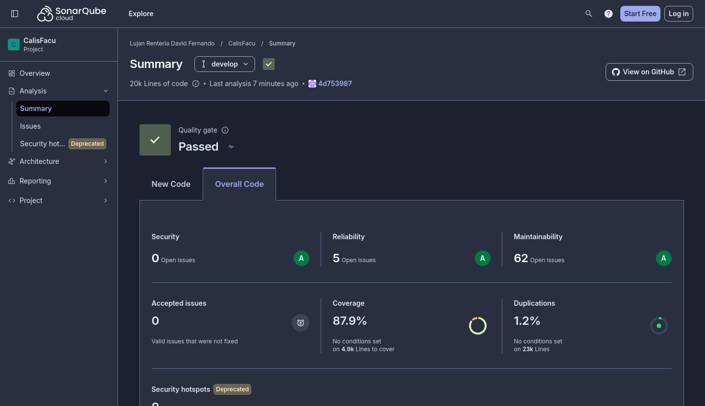

_Figura 17. SonarQube Cloud sobre `develop`: Quality Gate «Sonar way» aprobado, 0 vulnerabilidades, 0 security
hotspots, cobertura 87,9 % y duplicación 1,2 %. Ninguno de los issues de confiabilidad abiertos viene del código de
este informe; el único crítico (un `sort()` sin comparador en `boletin-padre.service.ts`, del 30/10) se corrigió en
`4d75398`._

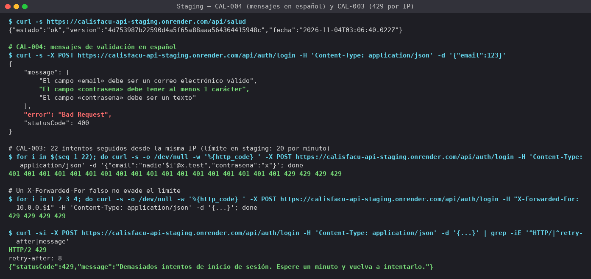

_Figura 18. CAL-004 y CAL-003 verificados en staging con `TRUST_PROXY=2`: el mensaje de validación en español; el
límite de 20 intentos por minuto cuenta todos los del minuto (también la petición inválida de arriba y una de
comprobación), por eso el 429 llega en el intento 19 de la ráfaga; con un `X-Forwarded-For` falso distinto en cada
petición el límite se mantiene._

### Hallazgo durante la verificación: el límite no funcionaba detrás de Cloudflare

La primera verificación en staging (con `TRUST_PROXY=1`) devolvió 429 en el intento 20, pero al repetirla después de otro
despliegue, 50 intentos seguidos respondieron 401. Las cabeceras (`server: cloudflare`, `cf-ray`) mostraron que delante
de Render está Cloudflare: la cadena es cliente → Cloudflare → balanceador de Render → API. Con un salto de confianza
Express tomaba la IP del borde de Cloudflare, que cambia entre peticiones, así que el contador casi nunca se llenaba (la
primera prueba probablemente corrió antes de que la variable entrara en vigor, cuando todas las peticiones compartían la
IP del balanceador). Con `TRUST_PROXY=2` se cuenta la IP del cliente, y como Cloudflare agrega la IP real a la derecha de
`X-Forwarded-For`, un valor falso enviado por el cliente no la reemplaza. Se corrigió en `aa5e09a` (con una prueba de
esa cadena de proxies en `app.setup.spec.ts`), se cambió la variable en Render y se verificó (Figura 18).

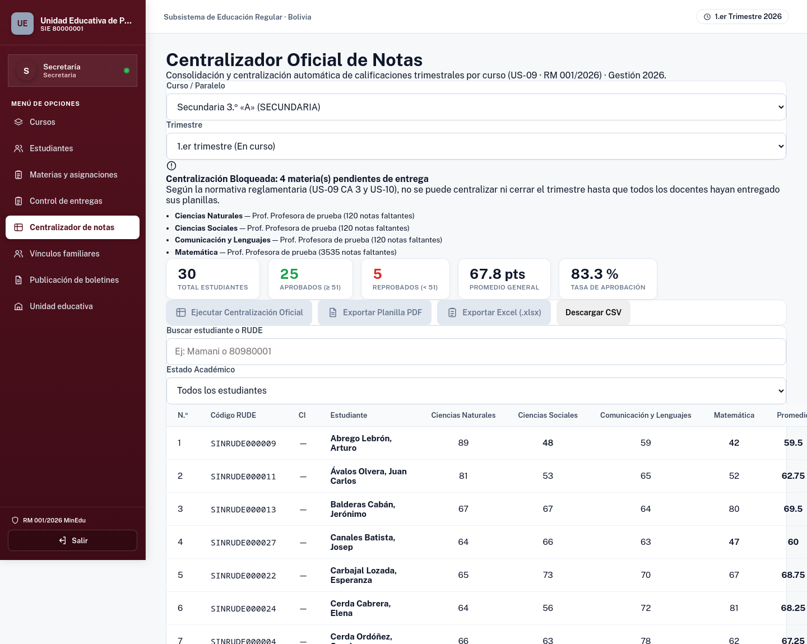

_Figura 19. El centralizador en staging (`https://calisfacu-web-staging.onrender.com`), con la API desplegada por
Jenkins._

## 9. Problemas encontrados en el camino

| Problema                                                                                     | Cómo se resolvió                                                                                                              |
| -------------------------------------------------------------------------------------------- | ----------------------------------------------------------------------------------------------------------------------------- |
| CAL-003 no limitaba en staging: con `TRUST_PROXY=1` se contaba la IP del borde de Cloudflare | `aa5e09a` y `TRUST_PROXY=2` en Render (sección 8)                                                                             |
| SonarQube: `sort()` sin comparador en `boletin-padre.service.ts` (crítico, del 30/10)        | `4d75398`                                                                                                                     |
| La segunda página de la planilla PDF no repetía los títulos de las columnas                  | `9275746`                                                                                                                     |
| En el Excel, las etiquetas del encabezado se cortaban en la columna angosta del N.º          | `54f4242`                                                                                                                     |
| «al menos 1 caracteres» en los mensajes de validación                                        | `4f4c43a`                                                                                                                     |
| `inicio-sesion.cy.ts` en rojo desde los menús nuevos del 02/11                               | `a828cb0`                                                                                                                     |
| La e2e de la cola de boletines falló una vez en local                                        | No es un defecto: una API local en `:3101` compartía el Redis y su worker tomaba los trabajos de la prueba. Sin ella, 226/226 |
| `control-entregas.cy.ts` falla si todas las materias ya están entregadas                     | La prueba depende de los datos (espera alguna pendiente). Con la base limpia pasa; queda anotado para Galvan                  |

## 10. Pendientes

**Del Sprint 3 (dependen de personas):** la demo con el cliente y el acta `revision-sprint3.md` (después se cierran los
issues T-043 a T-051), la prueba de usabilidad T-054 con 5 profesores, la auditoría T-055 de Galvan, las inspecciones
Fagan del SRS y del SAD con sus firmas, y la verificación de CAL-001 y CAL-002 por Galvan.

**Del Sprint 4:**

- **T-061** (correo de las alertas) y **T-062** (aviso por correo del boletín al padre) son de Galvan según el backlog.
  La alerta ya existe en la API (`correoEnviado: false` hasta T-061); `notificaciones` es el módulo donde va el correo.
- La pantalla de avisos del padre (`AvisosPadre.tsx`) sigue mostrando avisos armados en el navegador con «correo
  enviado, en 8 minutos» mientras no exista la API de T-062. No debe presentarse como evidencia del criterio 1 de US-12.
- `informe-cumplimiento-sprint4.md` (02/11) da por cumplidos criterios que dependían de esos datos simulados y deja
  T-057, T-058 y T-060 «esperando backend»; hay que actualizarlo con este informe.
- Se cierran los issues de CAL-003 y CAL-004 en GitHub cuando Galvan verifique la corrección en staging.
