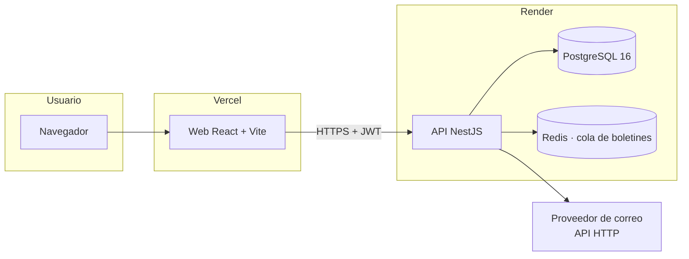
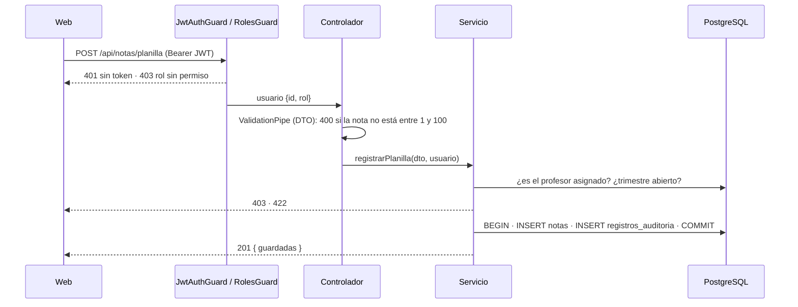
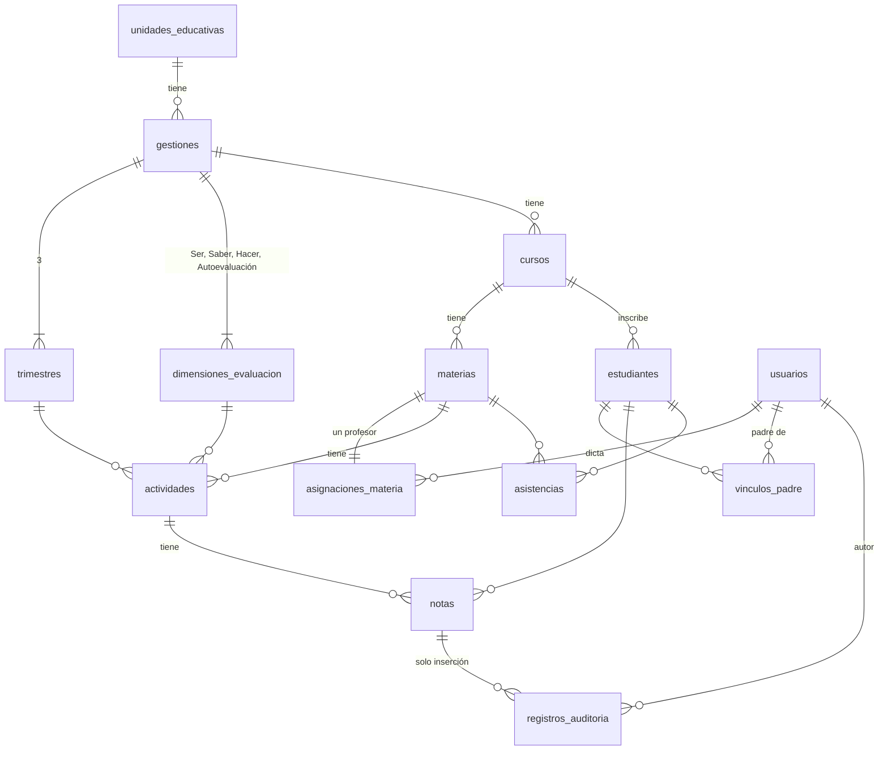

# 1. Propósito

Describe **cómo** está construido CalisFacu: componentes, modelo de datos, seguridad, despliegue y las decisiones que
cubren los RNF del SRS. Se inspecciona con Fagan el día 2 de la semana 1 (SQAP, Sección 6). Cada decisión importante
tiene su ADR en `docs/adr/`.

# 2. Vista general



| Componente    | Tecnología                              | Responsabilidad                                                                      |
| ------------- | --------------------------------------- | ------------------------------------------------------------------------------------ |
| Web           | React + Vite + TypeScript, en Vercel    | Pantallas de cada rol; valida la entrada y muestra los resultados que calcula la API |
| API           | NestJS + TypeScript, en Render (Docker) | Reglas de negocio, autorización, cálculo, auditoría, PDF                             |
| Base de datos | PostgreSQL 16 con TypeORM               | Datos académicos, notas y registro de auditoría                                      |
| Cola          | BullMQ + Redis (semana 3)               | Generación de boletines de cursos grandes (RNF-03, R05)                              |
| CI/CD         | Jenkins Multibranch (local, en Docker)  | Pruebas, análisis, despliegue a staging y producción                                 |
| Respaldos     | GitHub Actions (`backup.yml`)           | `pg_dump` diario cifrado (RNF-07)                                                    |

# 3. Estructura del repositorio

```
api/src/
  main.ts · app.module.ts · app.setup.ts     arranque y configuración común (también la usan las pruebas)
  common/decoradores.ts                      @Publico, @Roles, @UsuarioActual
  database/
    entities/                                entidades TypeORM (Sección 5)
    migrations/                              migraciones versionadas
    typeorm.config.ts · data-source.ts       configuración única (app, CLI, seed, pruebas)
    naming.strategy.ts                       snake_case en tablas y columnas
    seed.ts · reiniciar.ts                   datos sintéticos y reinicio (solo desarrollo)
  modules/
    salud/        GET /api/salud
    auth/         [crítico] login, JWT, bloqueo, guards de rol           US-17
    notas/        [crítico] actividades, planilla, acceso por asignación  US-01
    calculo/      [crítico] nota trimestral según la RM 001/2026          US-02
    auditoria/    [crítico] corrección con motivo e historial             US-04
api/test/        e2e con PostgreSQL real (autorizacion, notas, auditoria) y fixtures
web/src/         App, pages/, lib/ (cliente de la API y validación)
e2e/             Cypress
perf/            planes de JMeter
```

Los cuatro **módulos críticos** (SQAP, Tabla 4) los programa solo Lujan, con TDD, y exigen cobertura ≥ 90 % (M06).

# 4. Flujo de una petición



# 5. Modelo de datos



Decisiones del modelo:

- `notas.valor` es `numeric(5,2)` y el cálculo usa `decimal.js`: un 50,5 nunca se convierte en 50,4999… (ADR-0004).
- `registros_auditoria` es de **solo inserción**: un trigger de PostgreSQL rechaza `UPDATE` y `DELETE` (ADR-0005).
- Restricciones en la base, además de la validación de la API: nota entre 0 y 100, puntaje de dimensión positivo, número
  de trimestre entre 1 y 3, una nota por estudiante y actividad, un profesor por materia.
- La nota trimestral **no se guarda**: se calcula al consultarla, así que una corrección se refleja de inmediato.

# 6. Seguridad (RNF-04)

| Amenaza                          | Control                                                                                              | Verificación                     |
| -------------------------------- | ---------------------------------------------------------------------------------------------------- | -------------------------------- |
| Acceso sin sesión                | `JwtAuthGuard` global; solo `/api/salud` y `/api/auth/login` son públicas                            | `autorizacion.e2e-spec.ts` (401) |
| Rol sin permiso                  | `@Roles()` + `RolesGuard`                                                                            | M09 (403)                        |
| Profesor de otra materia         | `AccesoNotasService` comprueba la asignación profesor–materia                                        | M09 (403)                        |
| Padre que cambia el ID en la URL | Guard de vínculo padre–estudiante (US-20, semana 3)                                                  | M09 (403)                        |
| Fuerza bruta                     | Bloqueo de 15 minutos tras 5 intentos; mismo mensaje para correo inexistente y contraseña incorrecta | e2e de inicio de sesión          |
| Contraseñas                      | Hash argon2; la columna no se selecciona por defecto                                                 | Revisión de código               |
| Repudio de cambios               | Auditoría inmutable (ADR-0005)                                                                       | M15                              |
| Entrada maliciosa                | `ValidationPipe` con `whitelist` y `forbidNonWhitelisted`; consultas parametrizadas de TypeORM       | e2e (400)                        |
| Secretos                         | Solo en Jenkins Credentials, GitHub Secrets y el panel de cada plataforma                            | Auditoría de cierre              |
| Dependencias vulnerables         | `npm audit --audit-level=high`, Dependabot, SonarQube Cloud                                          | M08                              |

# 7. Despliegue

| Ambiente    | Rama o etiqueta                          | Dónde                                                                   | Base de datos                                   |
| ----------- | ---------------------------------------- | ----------------------------------------------------------------------- | ----------------------------------------------- |
| Local       | cualquier rama                           | `docker compose up` + `npm run -w api start:dev` / `npm run -w web dev` | PostgreSQL del compose                          |
| CI          | toda rama y PR                           | Agente de Jenkins                                                       | PostgreSQL de CI, una base desechable por build |
| Staging     | `develop`                                | Render (API) + Vercel (web)                                             | PostgreSQL de staging con seed sintético        |
| Rendimiento | etiqueta `vX.Y.Z-rc.N`                   | Agente de Jenkins                                                       | Base desechable con `seed:perf`                 |
| Producción  | etiqueta `vX.Y.Z` en `main` + aprobación | Render + Vercel                                                         | PostgreSQL de producción, respaldo diario       |

La API en Render se construye con su Dockerfile (`api/Dockerfile`) y aplica las migraciones al iniciar
(`npm run db:migrate && node dist/main.js`). El commit desplegado se lee de `RENDER_GIT_COMMIT` y lo comprueba el smoke test.

# 8. Cómo cubre la arquitectura cada RNF

| RNF    | Decisión                                                                                                              |
| ------ | --------------------------------------------------------------------------------------------------------------------- |
| RNF-01 | Cálculo puro y aislado en `CalculoService`, con aritmética decimal y dimensiones configurables por gestión (ADR-0004) |
| RNF-02 | Planilla en una sola transacción; E2E de Cypress en cada merge a `develop`                                            |
| RNF-03 | Cola BullMQ para boletines grandes (ADR-0006); prueba de carga en cada RC                                             |
| RNF-04 | Guards globales, acceso por asignación y por vínculo, auditoría inmutable (Sección 6)                                 |
| RNF-05 | Módulos por dominio, TypeScript estricto, ESLint + Prettier, umbrales de cobertura en Jest y Quality Gate             |
| RNF-06 | Interfaz con validación junto al campo y mensajes en español; prueba de usabilidad en la semana 3                     |
| RNF-07 | Monitor de `/api/salud`; respaldo diario cifrado con restauración probada (ADR-0003)                                  |

# 9. Decisiones de arquitectura (ADR)

| ADR                                                 | Decisión                                                               |
| --------------------------------------------------- | ---------------------------------------------------------------------- |
| [0001](../adr/0001-monorepo-nestjs-react.md)        | Monorepo con NestJS (API) y React + Vite (web) en TypeScript           |
| [0002](../adr/0002-typeorm-postgresql.md)           | TypeORM sobre PostgreSQL 16                                            |
| [0003](../adr/0003-jenkins-multibranch.md)          | Jenkins Multibranch como CI/CD; respaldos en GitHub Actions            |
| [0004](../adr/0004-calculo-decimal-configurable.md) | Cálculo con aritmética decimal y dimensiones configurables por gestión |
| [0005](../adr/0005-auditoria-inmutable.md)          | Auditoría de solo inserción con trigger de PostgreSQL                  |
| [0006](../adr/0006-cola-boletines.md)               | Cola BullMQ + Redis para los boletines                                 |
| [0007](../adr/0007-git-flow.md)                     | Git Flow con `develop` y `main` protegidas                             |

# 10. Historial

| Versión | Fecha      | Cambio                                              | Autor | Revisor |
| ------- | ---------- | --------------------------------------------------- | ----- | ------- |
| 1.0     | 13/10/2026 | Versión inicial: arquitectura del repositorio base. | Lujan | Galvan  |
