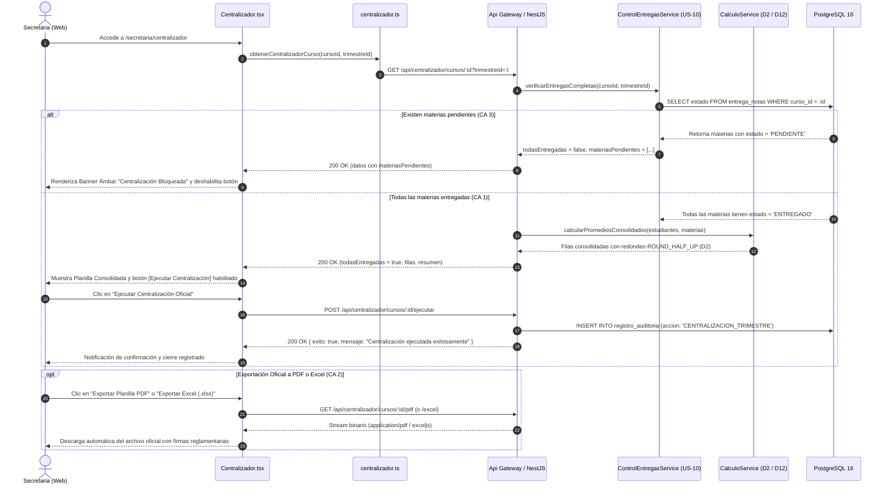

# CalisFacu v1.0 — Sprint 4

## Arquitectura de Flujos, Diagramas de Secuencia y Wireframes de Interfaz de Usuario

> **Proyecto:** CalisFacu v1.0 · Sistema Web de Registro de Calificaciones  
> **Normativa:** Resolución Ministerial 001/2026 del Ministerio de Educación (Bolivia)  
> **Equipo:** L-001 (Galvan / Lujan)  
> **Rol responsable de diseño y frontend:** Galvan (Tester / Responsable SQA / Dev Frontend)  
> **Auditor y desarrollador backend:** Lujan (Líder / Arquitecto / Dev Backend)  
> **Fecha:** Gestión II/2026 · Sprint 4 (Cierre y Consolidación)

---

# Tabla de Contenidos

1. [US-09 · Centralización de Notas (Secretaría)](#1-us-09--centralización-de-notas-secretaría)
   - [1.1 Flujo de Centralización Trimestral y Reglas Ministeriales (CA 1, CA 3, D2, D12)](#11-flujo-de-centralización-trimestral-y-reglas-ministeriales-ca-1-ca-3-d2-d12)
   - [1.2 Diagrama de Secuencia: Validación de Entregas y Ejecución de Centralización](#12-diagrama-de-secuencia-validación-de-entregas-y-ejecución-de-centralización)
   - [1.3 Wireframe 1 · Alerta de Bloqueo por Materias Pendientes de Entrega (CA 3)](#13-wireframe-1--alerta-de-bloqueo-por-materias-pendientes-de-entrega-ca-3)
   - [1.4 Wireframe 2 · Planilla Consolidada de Curso con Métricas y Filtros (CA 1)](#14-wireframe-2--planilla-consolidada-de-curso-con-métricas-y-filtros-ca-1)
   - [1.5 Wireframe 3 · Formato Oficial de Exportación en PDF y Excel con Firmas Reglamentarias (CA 2)](#15-wireframe-3--formato-oficial-de-exportación-en-pdf-y-excel-con-firmas-reglamentarias-ca-2)
2. [Matriz de Trazabilidad y Calidad SQAP (Sprint 4)](#2-matriz-de-trazabilidad-y-calidad-sqap-sprint-4)

---

# 1. US-09 · Centralización de Notas (Secretaría)

## 1.1 Flujo de Centralización Trimestral y Reglas Ministeriales (CA 1, CA 3, D2, D12)

El objetivo de la historia **US-09** es automatizar la consolidación de notas al cierre de cada trimestre escolar en unidades educativas bolivianas, eliminando la transcripción manual propensa a errores humanos.

```
       Secretaria autenticada
                 │
                 ▼
    [ /secretaria/centralizador ]
                 │
                 ▼
  Selecciona Curso (ej: 4.º «A») y Trimestre (ej: 1.º)
                 │
                 ▼
  Consulta de estado de entregas por materia (US-10)
                 │
   ¿ Todas las materias del curso tienen
       estado === 'ENTREGADO' ?
                 │
        ┌────────┴────────┐
        ▼                 ▼
     [ NO ]            [ SÍ ]
        │                 │
        │                 ├──────────────────────────────────────┐
        ▼                 ▼                                      ▼
 Alerta de Bloqueo   Habilita Centralización              Muestra Planilla
 (US-09 CA 3)        (US-09 CA 1)                         Consolidada
 - Lista pendientes  - Clic en [Ejecutar Centralización]  - Notas por materia
 - Docente a cargo   - Registra auditoría transaccional   - Promedio (D2 / D12)
 - Notas faltantes   - Cierre oficial del trimestre       - Aprobado / Reprobado
 - Botón bloqueado                                               │
                                                                 ▼
                                                      Opciones de Exportación
                                                      (US-09 CA 2)
                                                      - Exportar PDF oficial
                                                      - Exportar Excel (.xlsx)
                                                      - Descargar CSV
```

---

## 1.2 Diagrama de Secuencia: Validación de Entregas y Ejecución de Centralización



---

## 1.3 Wireframe 1 · Alerta de Bloqueo por Materias Pendientes de Entrega (CA 3)

Cuando una o más materias aún no han sido entregadas formalmente por sus docentes, el sistema bloquea preventivamente el cierre para evitar datos incompletos o actas inconsistentes.

```
+--------------------------------------------------------------------------------------------------------------------+
|  CalisFacu v1.0   |   Colegio Simón Bolívar (SIE: 80980123)                                  Marta Rojas (Secretaria) |
+--------------------------------------------------------------------------------------------------------------------+
| [Menú]            |  Inicio > Secretaría > Centralizador Oficial de Notas                                          |
| • Cursos          |                                                                                                |
| • Estudiantes     |  CENTRALIZADOR OFICIAL DE CALIFICACIONES                                                       |
| • Materias        |  Gestión Académica 2026 · Subsistema de Educación Regular (RM 001/2026)                        |
| • Entregas        |------------------------------------------------------------------------------------------------|
| • Centralizador*  |  Curso: [ Secundaria 4.º «A»              ▼ ]   Trimestre: [ 1.º Trimestre (En curso)      ▼ ] |
| • Vínculos        +------------------------------------------------------------------------------------------------+
| • Boletines       |                                                                                                |
| • Configuración   |  ⚠️ ALERTA: CENTRALIZACIÓN BLOQUEADA — 2 MATERIA(S) PENDIENTES DE ENTREGA                      |
|                   |  No se puede centralizar ni cerrar el trimestre hasta que todos los docentes hayan entregado   |
|                   |  formalmente sus planillas (Normativa US-09 CA 3 y Control de Entregas US-10).                 |
|                   |                                                                                                |
|                   |  • Lenguaje y Comunicación — Prof. Ana Flores (4 notas faltantes)                              |
|                   |  • Ciencias Naturales: Física — Prof. Roberto Gómez (Sin entrega registrada)                  |
|                   +------------------------------------------------------------------------------------------------+
|                   |                                                                                                |
|                   |  [🔒 Ejecutar Centralización Oficial (Bloqueado)]   [📄 Exportar PDF]   [📊 Exportar Excel]     |
|                   |                                                                                                |
+--------------------------------------------------------------------------------------------------------------------+
```

---

## 1.4 Wireframe 2 · Planilla Consolidada de Curso con Métricas y Filtros (CA 1)

Cuando todas las materias han sido entregadas, la secretaria puede visualizar la planilla general, aplicar filtros de búsqueda y ejecutar la centralización oficial.

```
+--------------------------------------------------------------------------------------------------------------------+
|  CENTRALIZADOR OFICIAL DE NOTAS · SECUNDARIA 4.º «A» · 1.º TRIMESTRE 2026                                          |
+--------------------------------------------------------------------------------------------------------------------+
|  ✅ TODAS LAS MATERIAS HAN SIDO ENTREGADAS                                                                         |
|  El curso cuenta con el 100 % de notas entregadas para este trimestre. Puede ejecutar la centralización oficial.   |
+--------------------------------------------------------------------------------------------------------------------+
|                                                                                                                    |
|  +------------------+  +------------------+  +------------------+  +------------------+  +------------------+      |
|  | TOTAL ALUMNOS    |  | APROBADOS (≥ 51) |  | REPROBADOS (< 51)|  | PROMEDIO GENERAL |  | TASA APROBACIÓN  |      |
|  |     30           |  |     28           |  |      2           |  |    72.4 pts      |  |     93.3 %       |      |
|  +------------------+  +------------------+  +------------------+  +------------------+  +------------------+      |
|                                                                                                                    |
|  Acciones: [⚡ Ejecutar Centralización Oficial]   [📄 Exportar Planilla PDF]   [📊 Exportar Excel]   [💾 CSV]      |
|                                                                                                                    |
|  Filtros: Buscar: [ Mamani Ramos                ]    Estado Académico: [ Todos los estudiantes               ▼ ]   |
|                                                                                                                    |
|  +-----+------------+-----------+----------------------+-------+-------+-------+-------+----------+--------------+ |
|  | N.º | RUDE       | CI        | ESTUDIANTE           | MAT   | LEN   | FIS   | QUI   | PROMEDIO | OBSERVACIÓN  | |
|  +-----+------------+-----------+----------------------+-------+-------+-------+-------+----------+--------------+ |
|  |  1  | 8098000101 | 10203040  | Mamani Ramos, Alex   |  85   |  90   |  88   |  92   |    89    |  APROBADO    | |
|  |  2  | 8098000102 | 10203041  | Condori Rojas, Bea   |  70   |  65   |  60   |  75   |    68    |  APROBADO    | |
|  |  3  | 8098000103 | 10203042  | Quispe Nina, Carlos  |  45   |  50   |  48   |  52   |    49    |  REPROBADO   | |
|  +-----+------------+-----------+----------------------+-------+-------+-------+-------+----------+--------------+ |
+--------------------------------------------------------------------------------------------------------------------+
```

---

## 1.5 Wireframe 3 · Formato Oficial de Exportación en PDF y Excel con Firmas Reglamentarias (CA 2)

Formato estructurado de impresión y archivo oficial según los requerimientos de la RM 001/2026 del Ministerio de Educación:

```
+--------------------------------------------------------------------------------------------------------------------+
|                                    ESTADO PLURINACIONAL DE BOLIVIA                                                 |
|                                        MINISTERIO DE EDUCACIÓN                                                     |
|                               VICEMINISTERIO DE EDUCACIÓN REGULAR                                                  |
|                                                                                                                    |
|                                 CENTRALIZADOR OFICIAL DE CALIFICACIONES                                            |
|                                                                                                                    |
|   Unidad Educativa: Colegio Simón Bolívar                 Código SIE: 80980123                                     |
|   Nivel: Educación Secundaria Comunitaria Productiva      Gestión: 2026                                            |
|   Año de Escolaridad: 4.º de Secundaria                   Paralelo: «A»                                            |
|   Periodo Evaluado: Primer Trimestre                      Fecha de Cierre: 02/11/2026                              |
+--------------------------------------------------------------------------------------------------------------------+
| N.º | CÓDIGO RUDE  | CI       | APELLIDOS Y NOMBRES          | MAT | LEN | FIS | QUI | ART | EF | PROM | OBSERVACIÓN |
+-----+--------------+----------+------------------------------+-----+-----+-----+-----+-----+----+------+-------------+
|  1  | 8098000101   | 10203040 | Mamani Ramos, Alejandro      | 85  | 90  | 88  | 92  | 95  | 90 |  90  | APROBADO    |
|  2  | 8098000102   | 10203041 | Condori Rojas, Beatriz       | 70  | 65  | 60  | 75  | 80  | 85 |  73  | APROBADO    |
|  3  | 8098000103   | 10203042 | Quispe Nina, Carlos          | 45  | 50  | 48  | 52  | 60  | 70 |  54  | APROBADO    |
|  4  | 8098000104   | 10203043 | Zeballos Cruz, Daniel        | 40  | 45  | 35  | 42  | 50  | 65 |  46  | REPROBADO   |
+-----+--------------+----------+------------------------------+-----+-----+-----+-----+-----+----+------+-------------+
| RESUMEN: Total Estudiantes: 30 | Aprobados: 28 | Reprobados: 2 | Promedio General: 72.4 pts | Aprobación: 93.3 %   |
+--------------------------------------------------------------------------------------------------------------------+
|                                                                                                                    |
|               _________________________________             _________________________________                      |
|                     Firma del Director(a)                         Firma del Maestro(a)                             |
|                      Sello Institucional                            Asesor de Curso                                |
|                                                                                                                    |
+--------------------------------------------------------------------------------------------------------------------+
```

---

# 2. Matriz de Trazabilidad y Calidad SQAP (Sprint 4)

| Historia  | Criterio de Aceptación                        | Componente Frontend                      | Módulo / Servicio Backend                      | Métrica SQAP        | Estado                          |
| :-------- | :-------------------------------------------- | :--------------------------------------- | :--------------------------------------------- | :------------------ | :------------------------------ |
| **US-09** | **CA 1:** Centralización automática al cierre | `Centralizador.tsx`, `centralizador.ts`  | `CentralizadorService`, `CalculoService`       | M01 ($\ge 90\,\%$)  | Frontend OK · Esperando Backend |
| **US-09** | **CA 2:** Exportación oficial PDF y Excel     | `descargarCentralizadorPdf/Excel/Csv`    | `CentralizadorExportService` (PDFKit, ExcelJS) | M10 (Accesibilidad) | Frontend OK · Esperando Backend |
| **US-09** | **CA 3:** Bloqueo si hay materias pendientes  | Banner de Alerta, `evaluarEntregasCurso` | Guard / Validador en `POST /ejecutar`          | M16 (0 errores)     | Frontend OK · Esperando Backend |
